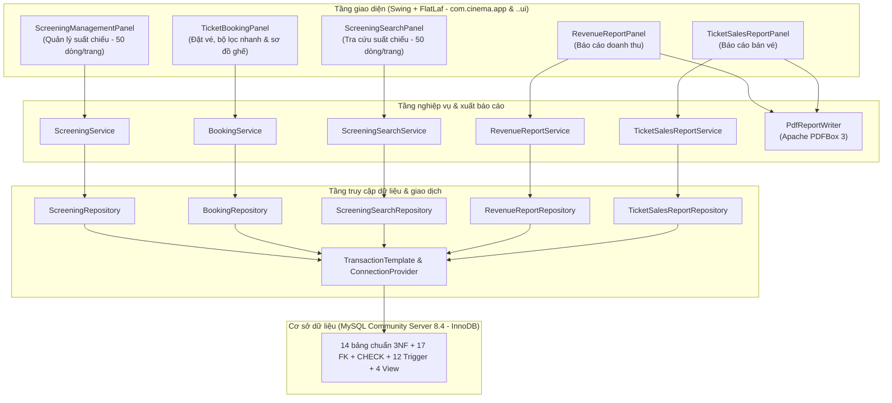

# Kiến trúc ứng dụng quản lý chuỗi rạp chiếu phim

## 1. Tổng quan các tầng

Ứng dụng được tổ chức theo các tầng tách biệt theo từng nhóm chức năng trên **Java 21**, **Java Swing (FlatLaf)** và **JDBC (MySQL Connector/J)** kết nối tới **MySQL Community Server 8.4 (InnoDB)**.

---

## 2. Nguyên tắc tổ chức mã nguồn và dữ liệu

1. **Tách giao diện khỏi truy vấn SQL và phân trang rõ ràng:**
   - Các lớp trong gói `..ui` và `com.cinema.app` chỉ hiển thị dữ liệu từ các lớp `domain` (`PageResult`, `SearchPageResult`, Java `record`), nhận thao tác người dùng và gọi tầng `Service`. Quy tắc phân tầng được kiểm tra tự động trong `ArchitectureComplianceTest`.
   - Các danh sách lớn dùng phân trang `50 dòng/trang` (màn hình quản lý suất chiếu và tra cứu) hoặc bộ lọc chi nhánh/ngày kèm hiển thị tổng số dòng (màn hình đặt vé).

2. **Thiết kế bảng chuẩn 3NF kết hợp ràng buộc ở CSDL:**
   - Bảng `ticket` lưu `(ticket_id, booking_id, seat_id, unit_price, ticket_status, cancelled_at)`, không lưu lặp `screening_id` để tránh phụ thuộc bắc cầu `ticket_id -> booking_id -> screening_id`.
   - Bảng `screening_seat_lock(screening_id, seat_id, ticket_id)` lưu các ghế đang được giữ bởi vé `VALID` và được đồng bộ qua trigger ở tầng MySQL.

3. **Giao dịch và kiểm soát đồng thời:**
   - **Chống trùng lịch chiếu trong cùng phòng (`BR-06`):** `ScreeningService` mở giao dịch (`TransactionTemplate`), khóa dòng phòng chiếu (`SELECT room_id, active FROM screening_room WHERE room_id = ? FOR UPDATE`), kiểm tra giao khoảng thời gian `[start_time, end_time)` rồi mới ghi dữ liệu, đồng thời có trigger `trg_screening_validate_ins`/`upd` kiểm tra tại CSDL.
   - **Chống bán trùng ghế khi đặt vé đồng thời (`BR-10`):** `BookingService` mở giao dịch, khóa dòng suất chiếu (`SELECT screening_id, room_id, base_price, status FROM screening WHERE screening_id = ? FOR UPDATE`), kiểm tra `screening_seat_lock` và ghi `booking`, `ticket`, `payment` trong cùng giao dịch. Khóa chính `PRIMARY KEY (screening_id, seat_id)` trên `screening_seat_lock` ngăn ghi trùng ghế ở mức chỉ mục InnoDB và giải phóng ghế khi vé chuyển sang `CANCELLED`.

4. **Đối soát doanh thu nhất quán (`BR-14`, `BR-15`):**
   - Mỗi đơn đặt vé (`booking`) có tối đa một giao dịch thanh toán `SUCCESS` (nhờ chỉ mục duy nhất có điều kiện `uq_payment_one_success` và trigger kiểm tra).
   - Doanh thu chỉ cộng `ticket.unit_price` của các vé `VALID` thuộc đơn `CONFIRMED` có thanh toán `SUCCESS`, không tính các đơn `PENDING`, `FAILED` hoặc `CANCELLED`/`REFUNDED`.
