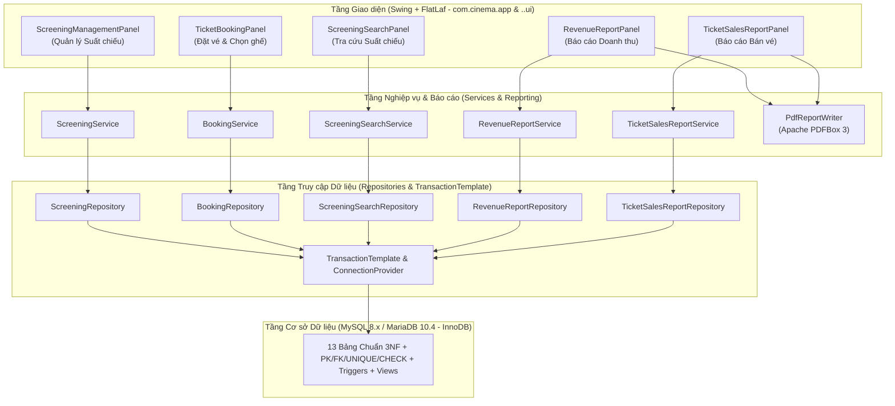

# ARCHITECTURE.md — Kiến trúc Hệ thống Quản lý Chuỗi Rạp Chiếu Phim

## 1. Tổng quan Kiến trúc (Architecture Overview)

Ứng dụng **Hệ thống Quản lý Chuỗi Rạp Chiếu Phim** được thiết kế theo kiến trúc **Desktop Đa tầng Hướng tính năng (Feature-Oriented Layered Architecture)** trên nền tảng **Java 21 LTS**, **Java Swing (FlatLaf)** và **JDBC** kết nối trực tiếp tới hệ quản trị CSDL quan hệ (**MySQL 8.x / MariaDB 10.4**).

---

## 2. Nguyên tắc Thiết kế Cốt lõi (Design Principles)

1. **Tách biệt tuyệt đối SQL khỏi Giao diện (Zero SQL in UI):**
   - Các lớp trong gói `..ui` và `com.cinema.app` chỉ làm nhiệm vụ hiển thị dữ liệu từ các đối tượng `domain` (Java `record`), thu nhận thao tác người dùng và gọi `Service`.
   - Quy tắc này được kiểm tra tự động bằng bài test **ArchUnit** (`ArchitectureComplianceTest`).

2. **Bảo vệ Toàn vẹn Kép (Dual-Layer Integrity Enforcement):**
   - **Tầng Dịch vụ (Java Service):** Kiểm tra dữ liệu đầu vào, định dạng, quy tắc nghiệp vụ và trả về thông báo tiếng Việt thân thiện cho người dùng.
   - **Tầng CSDL (InnoDB Constraints + Triggers):** Đóng vai trò chốt chặn cuối cùng (Last Line of Defense) thông qua khóa chính (PK), khóa ngoại (FK), ràng buộc duy nhất (UNIQUE), ràng buộc miền giá trị (CHECK), cột sinh tự động (Generated Column) và Trigger (`BEFORE INSERT` / `BEFORE UPDATE`). Ngay cả khi thao tác trực tiếp bằng câu lệnh SQL bên ngoài ứng dụng, dữ liệu sai quy tắc vẫn bị từ chối.

3. **Kiểm soát Giao dịch & Xử lý Đồng thời (Concurrency & Transaction Safety):**
   - **Chống trùng lịch chiếu trong cùng phòng:** Khi thêm hoặc cập nhật suất chiếu, `ScreeningService` mở giao dịch (`TransactionTemplate`), khóa dòng phòng chiếu (`SELECT room_id FROM screening_room WHERE room_id = ? FOR UPDATE`), kiểm tra xung đột khoảng thời gian `[start_time, end_time)` rồi mới thực hiện ghi dữ liệu. Đồng thời, Trigger `trg_screening_no_overlap_ins` và `trg_screening_no_overlap_upd` ở CSDL kiểm tra lại lần nữa.
   - **Chống bán trùng ghế khi đặt vé đồng thời:** Khi đặt vé, `BookingService` mở giao dịch, khóa dòng suất chiếu (`SELECT screening_id, room_id, base_price, status FROM screening WHERE screening_id = ? FOR UPDATE`), kiểm tra trạng thái ghế và chèn bản ghi vào `booking`, `ticket`, `payment`. Ngoài ra, cột sinh `active_seat_key` (`CASE WHEN ticket_status = 'VALID' THEN CONCAT(screening_id, '-', seat_id) ELSE NULL END`) có chỉ mục `UNIQUE` đảm bảo CSDL không bao giờ lưu 2 vé `VALID` cho cùng một ghế trong cùng một suất chiếu, đồng thời cho phép bán lại ghế đó sau khi vé cũ chuyển sang `CANCELLED`.

4. **Ghi nhận Doanh thu Nhất quán & Chống Nhân bản Số liệu (Single Source of Truth for Revenue):**
   - Mỗi đơn đặt vé (`booking`) chỉ được phép có tối đa **01** giao dịch thanh toán ở trạng thái `SUCCESS` (được bảo vệ bởi cột sinh `active_success_booking` có ràng buộc `UNIQUE` và Trigger).
   - Doanh thu được định nghĩa duy nhất: **Tổng `ticket.unit_price` của các vé có `ticket_status = 'VALID'` thuộc các đơn đặt vé có `booking_status = 'CONFIRMED'` và có thanh toán `payment_status = 'SUCCESS'`**, tính theo thời điểm thanh toán `paid_at` (đối với Báo cáo Doanh thu) hoặc theo suất chiếu (đối với Báo cáo Bán vé).
   - Các truy vấn báo cáo sử dụng `EXISTS` hoặc tổng hợp con theo `booking_id` trước khi kết nối, triệt tiêu hoàn toàn nguy cơ nhân bản dòng (join fan-out) khi một đơn có nhiều lần thử thanh toán (`FAILED` rồi mới `SUCCESS`).
