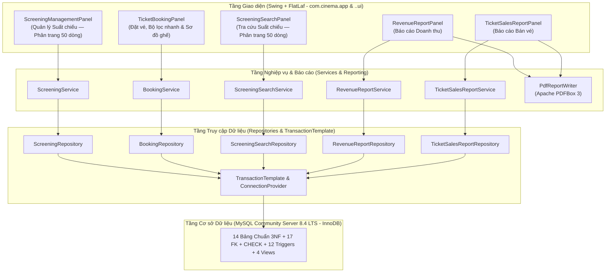

# ARCHITECTURE.md — Kiến trúc Hệ thống Quản lý Chuỗi Rạp Chiếu Phim

## 1. Tổng quan Kiến trúc (Architecture Overview)

Ứng dụng **Hệ thống Quản lý Chuỗi Rạp Chiếu Phim** được thiết kế theo kiến trúc **Desktop Đa tầng Hướng tính năng (Feature-Oriented Layered Architecture)** trên nền tảng **Java 21 LTS**, **Java Swing (FlatLaf)** và **JDBC (MySQL Connector/J)** kết nối trực tiếp tới hệ quản trị CSDL quan hệ **MySQL Community Server 8.4 LTS (InnoDB)**.

---

## 2. Nguyên tắc Thiết kế Cốt lõi (Design Principles)

1. **Tách biệt tuyệt đối SQL khỏi Giao diện & Không Cắt ngầm Dữ liệu (`Zero SQL in UI` & `Explicit Pagination`):**
   - Các lớp trong gói `..ui` và `com.cinema.app` chỉ làm nhiệm vụ hiển thị dữ liệu từ các đối tượng `domain` (`PageResult`, `SearchPageResult`, Java `record`), thu nhận thao tác người dùng và gọi `Service`. Quy tắc này được kiểm tra tự động bằng **ArchUnit** (`ArchitectureComplianceTest`).
   - Toàn bộ các danh sách lớn đã loại bỏ giới hạn ngầm `LIMIT 1000` và thay bằng **phân trang tường minh `50 dòng/trang`** (Màn hình 1 & 3) hoặc **bộ lọc nhanh Chi nhánh/Ngày hiển thị rõ tổng số dòng** (Màn hình 2).

2. **Chuẩn hóa 3NF Nghiêm ngặt Kết hợp Toàn vẹn Kép (True 3NF + Dual-Layer Integrity):**
   - Bảng `ticket` chỉ lưu `(ticket_id, booking_id, seat_id, unit_price, ticket_status, cancelled_at)`, loại bỏ hoàn toàn phụ thuộc bắc cầu `ticket_id -> booking_id -> screening_id`.
   - Bảng chuẩn 3NF `screening_seat_lock(screening_id, seat_id, ticket_id)` lưu khóa giữ ghế của các vé đang `VALID`, được đồng bộ tự động bởi Trigger ở tầng CSDL.

3. **Kiểm soát Giao dịch & Xử lý Đồng thời (Concurrency & Transaction Safety):**
   - **Chống trùng lịch chiếu trong cùng phòng (`BR-06`):** `ScreeningService` mở giao dịch (`TransactionTemplate`), khóa dòng phòng chiếu (`SELECT room_id, active FROM screening_room WHERE room_id = ? FOR UPDATE`), kiểm tra xung đột khoảng thời gian `[start_time, end_time)` rồi mới thực hiện ghi dữ liệu, kết hợp Trigger `trg_screening_validate_ins`/`upd`.
   - **Chống bán trùng ghế khi đặt vé đồng thời (`BR-10`):** `BookingService` mở giao dịch, khóa dòng suất chiếu (`SELECT screening_id, room_id, base_price, status FROM screening WHERE screening_id = ? FOR UPDATE`), kiểm tra `screening_seat_lock` và chèn nguyên tử `booking`, `ticket`, `payment`. Khóa chính `PRIMARY KEY (screening_id, seat_id)` trên `screening_seat_lock` đóng vai trò chốt chặn phần cứng B-Tree InnoDB cuối cùng, đồng thời tự động giải phóng ghế khi vé chuyển sang `CANCELLED`.

4. **Ghi nhận Doanh thu Nhất quán & Chống Nhân bản Số liệu (`BR-14`, `BR-15`):**
   - Mỗi đơn đặt vé (`booking`) chỉ được phép có tối đa **01** giao dịch thanh toán ở trạng thái `SUCCESS` (được bảo vệ bởi chỉ mục vật lý có điều kiện `uq_payment_one_success` và Trigger).
   - Doanh thu thực thu được định nghĩa duy nhất: **Tổng `ticket.unit_price` của các vé `VALID` thuộc đơn `CONFIRMED` có thanh toán `SUCCESS`**, loại trừ hoàn toàn các đơn `PENDING`, `FAILED` và `CANCELLED`/`REFUNDED`.
