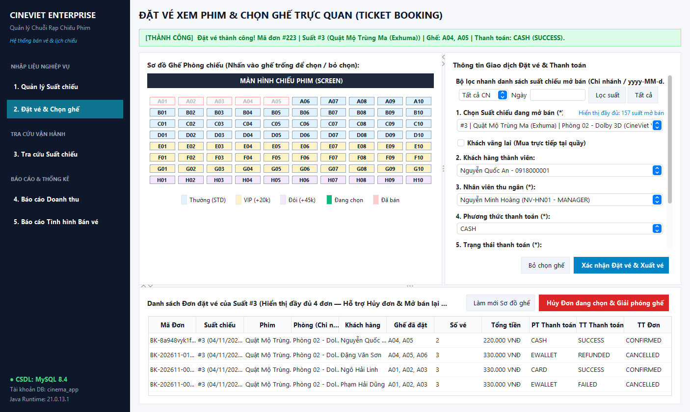

# Hệ thống quản lý chuỗi rạp chiếu phim

**Bài tập lớn môn Cơ sở dữ liệu · Nhóm 8 · Học viện Công nghệ Bưu chính Viễn thông**

Lớp INT1313-20261-01 · Giảng viên Nguyễn Quỳnh Chi

[**Báo cáo học phần (PDF)**](docs/academic-report/BaoCao_QuanLyChuoiRap.pdf) · [Bản Word](docs/academic-report/BaoCao_QuanLyChuoiRap.docx) · [Sơ đồ ERD Chen](docs/erd/ER.drawio.pdf) · [Lược đồ quan hệ](docs/erd/luoc-do-quan-he.drawio.pdf) · [Kịch bản bảo vệ 15 phút](DEMO_GUIDE.md)

Khi hai nhân viên cùng bán một ghế cho cùng một suất chiếu, hệ thống phải giữ chỗ cho đúng một vé. Nhóm giải quyết bài toán này bằng giao dịch đặt vé và khóa chính ghép `(screening_id, seat_id)` trong bảng `screening_seat_lock`. Ứng dụng Java Swing cho phép nhân viên lập lịch chiếu, tra cứu suất, đặt vé trên sơ đồ ghế và xuất báo cáo doanh thu, bán vé từ dữ liệu MySQL.

## Nội dung bài nộp

| Nội dung | Tài liệu đối chiếu |
| --- | --- |
| Yêu cầu dữ liệu và nghiệp vụ | [Phân tích yêu cầu](docs/requirements/requirements.md) · [Quy tắc nghiệp vụ](docs/requirements/business-rules.md) |
| Thiết kế dữ liệu và chuẩn hóa | [Thuyết minh ERD](docs/erd/erd-explanation.md) · [Từ điển dữ liệu 14 bảng](docs/relational-model/schema-design.md) · [Phụ thuộc hàm, chuẩn 3NF và phép tách kết nối không mất thông tin](docs/normalization/normalization.md) |
| Cài đặt trên MySQL | [Định nghĩa bảng](database/schema/01_schema.sql) · [17 khóa ngoại](database/schema/01b_foreign_keys.sql) · [12 trigger](database/schema/02_triggers.sql) · [Các view](database/schema/03_views.sql) · [Dữ liệu mẫu](database/seed/10_seed.sql) |
| Hai chức năng nhập liệu, tra cứu và báo cáo | [SQL theo từng màn hình](docs/sql-features/functional-sql-mapping.md) · [Truy vấn đối chiếu](database/queries/functional_sql_verification.sql) · [Kiến trúc ứng dụng](ARCHITECTURE.md) |
| Báo cáo xuất từ ứng dụng | [Doanh thu theo ngày thanh toán (PDF)](reports/exports/BaoCaoDoanhThu_Mau.pdf) · [Bán vé và tỷ lệ lấp đầy theo ngày chiếu (PDF)](reports/exports/BaoCaoBanVe_Mau.pdf) |



## Chạy ứng dụng từ mã nguồn

Cần **JDK 21**, **Maven** và **MySQL Community Server 8.4**. Chạy các lệnh PowerShell dưới đây từ thư mục gốc của dự án.

1. Tạo `config/application.properties` từ [tệp cấu hình mẫu](config/application.properties.example). Điền mật khẩu cục bộ của `cinema_app`. Cấu hình `db.url` trỏ đến `cinema_chain` và `test.db.url` trỏ đến `cinema_chain_test`. Git bỏ qua tệp chứa mật khẩu.
2. Khởi động MySQL. Nếu máy đã có `cinema_chain` của dự án, chuyển sang bước 3. Khi cài lần đầu trên Windows với MySQL tại `%USERPROFILE%\.mysql\mysql-8.4` và dữ liệu tại `%USERPROFILE%\.mysql\data-8.4`, dùng hai lệnh sau để khởi động máy chủ và khởi tạo cơ sở dữ liệu.

   ```powershell
   powershell -NoProfile -ExecutionPolicy Bypass -File database/start_mysql84.ps1
   powershell -NoProfile -ExecutionPolicy Bypass -File database/setup.ps1 -TargetDatabase cinema_chain
   ```

   Với MySQL cài ở vị trí khác, tạo schema trống `cinema_chain` dùng `utf8mb4_unicode_ci`. Dùng tài khoản quản trị chạy lần lượt các tệp trong hàng **Cài đặt trên MySQL** ở bảng trên, từ định nghĩa bảng đến dữ liệu mẫu. Cấp cho `cinema_app` các quyền `SELECT`, `INSERT`, `UPDATE`, `DELETE`, `SHOW VIEW` và `EXECUTE` trên schema này.
3. Biên dịch và mở ứng dụng. Có thể dùng lệnh này ngay sau khi tải mã nguồn.

   ```powershell
   .\mvnw.cmd compile exec:java "-Dexec.mainClass=com.cinema.app.Main"
   ```

## Kiểm thử và kết quả

Bản kết quả lưu trong Git ngày **22/11/2026** ghi nhận **104/104 bài kiểm thử Java đạt** trên JDK 21 và MySQL 8.4, với 15 bộ kiểm thử và 0 bài bị bỏ qua. Trên bộ dữ liệu mẫu, báo cáo doanh thu ghi nhận **125 đơn, 292 vé và 35.165.000 đồng**, khớp với truy vấn SQL độc lập. [Kết quả chi tiết](docs/demo/verification-results.md) · [Kết quả từng bộ kiểm thử (JSON)](verification/test-results/summary.json) · [Các tình huống kiểm thử](docs/demo/test-cases.md)

Để chạy lại toàn bộ quy trình trên máy Windows đã cấu hình như trên, cần thêm **Python 3** và một phiên desktop để mở Swing. Chạy trong bản sao mã nguồn dành cho kiểm thử vì Maven dọn thư mục `target/`. Bộ kiểm chứng dùng `cinema_chain_test` cho các thao tác ghi, kiểm tra năm màn hình, hai PDF, dữ liệu sau khi khởi động lại và so sánh SHA-256 của `cinema_chain` trước và sau khi chạy.

```powershell
powershell -NoProfile -ExecutionPolicy Bypass -File database/setup.ps1 -TargetDatabase cinema_chain_test
powershell -NoProfile -ExecutionPolicy Bypass -File database/verify_all.ps1
```

Phần thanh toán VNPay dùng môi trường sandbox để minh họa luồng giao dịch. [Phạm vi thanh toán thử nghiệm](docs/requirements/sandbox-payment.md)

## Thành viên nhóm 8

| Mã sinh viên | Họ và tên |
| --- | --- |
| B24DCCN152 | Hoàng Tiến Dũng |
| B24DCCN504 | Phạm Thế Sơn |
| B24DCCN537 | Phạm Tiến Thành |
| B24DCCN053 | Lê Nguyên Bá |
| B24DCCN570 | Dương Bảo Trung |
