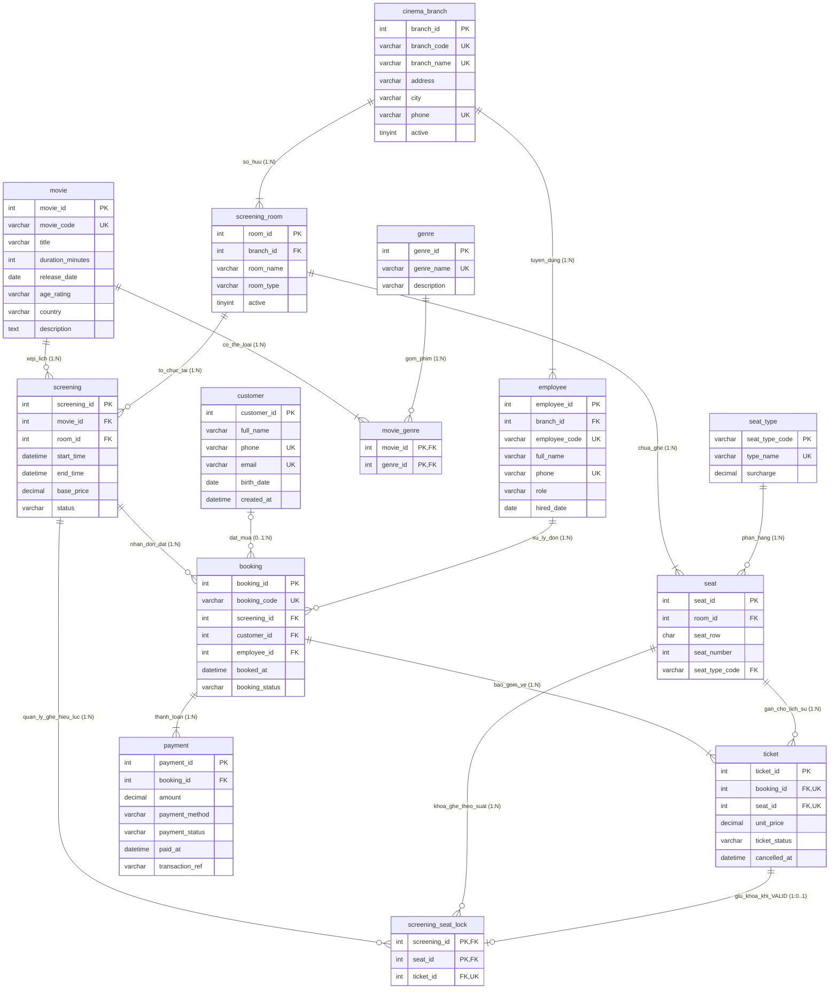

# MÔ HÌNH THỰC THỂ – LIÊN KẾT (ENTITY-RELATIONSHIP DIAGRAM)
**(Tài liệu đáp ứng Tiêu chí R2 — 2.5 điểm)**

---

## 1. Tổng quan Sơ đồ Thực thể – Liên kết (ERD)

Mô hình Thực thể – Liên kết của **Hệ thống Quản lý Chuỗi Rạp Chiếu Phim** được xây dựng gồm **12 tập thực thể nghiệp vụ chính**, **01 quan hệ kết hợp nhiều – nhiều (`movie_genre`)** và **01 thực thể kết hợp cấp phát ghế hiệu lực (`screening_seat_lock`)**, tương ứng chính xác với **14 bảng quan hệ đạt chuẩn 3NF nghiêm ngặt** khi ánh xạ sang mô hình quan hệ.

Đặc biệt, trong mô hình ERD và lược đồ quan hệ chuẩn 3NF:
- Thực thể **`Ticket` (`ticket`)** liên kết với **`Screening` (`screening`)** thông qua **`Booking` (`booking`)**, **không** tạo liên kết dư thừa trực tiếp `screening -> ticket` nhằm triệt tiêu hoàn toàn phụ thuộc hàm bắc cầu $\text{ticket\_id} \to \text{booking\_id} \to \text{screening\_id}$.
- Thực thể kết hợp **`ScreeningSeatLock` (`screening_seat_lock`)** biểu diễn trạng thái cấp phát ghế đang có hiệu lực (`VALID`) của một tấm vé trên cặp `(screening_id, seat_id)`, vừa bảo toàn lịch sử mọi lần hủy vé/đặt lại ghế trong `ticket`, vừa đảm bảo tại mọi thời điểm mỗi ghế trong một suất chiếu chỉ gắn với tối đa một vé hợp lệ ngay ở mức khóa chính CSDL.

Hệ thống cung cấp đồng thời:
1. **Sơ đồ ERD mức khái niệm (Chen Notation):** Mã nguồn tại `docs/erd/erd-chen.puml`, ảnh kết xuất tại `docs/erd/erd-chen.png` và `docs/erd/erd-chen.svg`.
2. **Sơ đồ ERD mức logic (Crow's Foot Notation):** Mã nguồn tại `docs/erd/erd-logical.puml`, ảnh kết xuất tại `docs/erd/erd-logical.png` và `docs/erd/erd-logical.svg`.
3. **Sơ đồ Mermaid ER trực quan:** Hiển thị trực tiếp dưới đây.

---

## 2. Thuyết minh Chi tiết 14 Tập Thực thể & Thực thể Kết hợp (Entities)

*(Lưu ý học thuật: Cột "Khóa dự tuyển khác (Alternate Keys)" dưới đây chỉ liệt kê các khóa tối thiểu định danh duy nhất trên **toàn bộ các bộ (rows)** của quan hệ; các biểu thức chỉ mục có điều kiện trên tập con trạng thái không phải khóa dự tuyển của quan hệ).*

| STT | Tên Thực thể (Code / SQL) | Tên Tiếng Việt | Khóa chính (PK) | Khóa dự tuyển khác trên toàn bảng (Alternate Keys) | Giải thích Ý nghĩa Nghiệp vụ |
|---:|---|---|---|---|---|
| 1 | `CinemaBranch` (`cinema_branch`) | Chi nhánh rạp | `branch_id` | `branch_code`, `branch_name`, `phone` | Đại diện cho một cụm rạp chiếu phim thuộc chuỗi rạp đặt tại một địa điểm/thành phố cụ thể. |
| 2 | `ScreeningRoom` (`screening_room`) | Phòng chiếu | `room_id` | `(branch_id, room_name)` | Không gian chiếu phim vật lý thuộc một chi nhánh rạp, phân loại theo công nghệ `2D`, `3D`, `IMAX`. |
| 3 | `SeatType` (`seat_type`) | Hạng ghế | `seat_type_code` | `type_name` | Danh mục phân hạng ghế (`STD` – Ghế Thường, `VIP` – Ghế VIP, `COUPLE` – Ghế Đôi) và phụ thu chuẩn (`surcharge`). |
| 4 | `Seat` (`seat`) | Ghế vật lý | `seat_id` | `(room_id, seat_row, seat_number)` | Vị trí chỗ ngồi cố định trong một phòng chiếu, xác định bởi hàng ghế (`A`..`H`) và số thứ tự ghế. |
| 5 | `Movie` (`movie`) | Phim điện ảnh | `movie_id` | `movie_code` | Tác phẩm điện ảnh được đưa vào khai thác thương mại với thời lượng (`duration_minutes`) và độ tuổi giới hạn (`age_rating`). |
| 6 | `Genre` (`genre`) | Thể loại phim | `genre_id` | `genre_name` | Danh mục thể loại điện ảnh phục vụ phân loại và tìm kiếm phim. |
| 7 | `MovieGenre` (`movie_genre`) | Phim – Thể loại | `(movie_id, genre_id)` | — | Thực thể kết hợp giải quyết mối quan hệ $M:N$ giữa Phim và Thể loại. |
| 8 | `Screening` (`screening`) | Suất chiếu | `screening_id` | — | Một lịch trình chiếu cụ thể của một bộ phim tại một phòng chiếu trong khoảng thời gian `[start_time, end_time)` với mức giá cơ sở `base_price`. |
| 9 | `Customer` (`customer`) | Khách hàng | `customer_id` | `phone`, `email` | Khách hàng đăng ký thành viên của chuỗi rạp để lưu lịch sử mua vé và nhận thông tin. |
| 10 | `Employee` (`employee`) | Nhân viên | `employee_id` | `employee_code`, `phone` | Nhân sự làm việc tại chi nhánh rạp gồm Thu ngân (`CASHIER`), Quản lý chi nhánh (`MANAGER`) và Kế toán (`ACCOUNTANT`). |
| 11 | `Booking` (`booking`) | Đơn đặt vé | `booking_id` | `booking_code` | Phiên giao dịch đặt mua một hoặc nhiều vé cho một suất chiếu xác định (do khách thành viên hoặc khách vãng lai thực hiện). |
| 12 | `Ticket` (`ticket`) | Vé xem phim | `ticket_id` | `(booking_id, seat_id)` | Tấm vé cụ thể gán một ghế (`seat_id`) trong một đơn đặt vé (`booking_id`) với đơn giá lịch sử `unit_price` và trạng thái `VALID` / `CANCELLED`. Suất chiếu được xác định qua `booking` để đảm bảo chuẩn 3NF. |
| 13 | `ScreeningSeatLock` (`screening_seat_lock`) | Khóa ghế hiệu lực | `(screening_id, seat_id)` | `ticket_id` | Thực thể kết hợp lưu sự phân bổ ghế đang có hiệu lực (`VALID`) của tấm vé `ticket_id` trên cặp `(screening_id, seat_id)`. Khi vé bị hủy (`CANCELLED`), bản ghi khóa ghế được giải phóng để cho phép bán lại ghế đó cho đơn mới. |
| 14 | `Payment` (`payment`) | Giao dịch thanh toán | `payment_id` | — | Bản ghi giao dịch thanh toán cho đơn đặt vé (`PENDING`, `SUCCESS`, `FAILED`, `REFUNDED`). Ràng buộc tối đa 01 giao dịch `SUCCESS` cho mỗi `booking_id` là ràng buộc duy nhất trên tập con trạng thái, thực thi ở mức vật lý. |

---

## 3. Thuyết minh Chi tiết Các Mối Quan hệ và Bản số (Relationships & Cardinalities)

1. **`cinema_branch` (1) — Sở hữu — (1..N) `screening_room`:**
   - Một chi nhánh rạp phải có ít nhất một phòng chiếu và có thể sở hữu nhiều phòng chiếu. Mỗi phòng chiếu thuộc về duy nhất một chi nhánh (`screening_room.branch_id NOT NULL`).
2. **`cinema_branch` (1) — Tuyển dụng — (1..N) `employee`:**
   - Một chi nhánh quản lý nhiều nhân viên; mỗi nhân viên biên chế tại một chi nhánh xác định (`employee.branch_id NOT NULL`).
3. **`screening_room` (1) — Chứa ghế — (1..N) `seat`:**
   - Mỗi phòng chiếu có nhiều ghế vật lý được lắp đặt cố định; mỗi ghế vật lý thuộc duy nhất một phòng chiếu (`seat.room_id NOT NULL`).
4. **`seat_type` (1) — Phân hạng — (0..N) `seat`:**
   - Một hạng ghế (`STD`, `VIP`, `COUPLE`) áp dụng cho nhiều ghế; mỗi ghế vật lý có đúng một hạng ghế (`seat.seat_type_code NOT NULL`).
5. **`movie` (0..N) — Thuộc thể loại (`movie_genre`) — (1..N) `genre`:**
   - Một bộ phim có ít nhất một hoặc nhiều thể loại; một thể loại có thể gắn cho nhiều bộ phim. Biểu diễn qua bảng `movie_genre(movie_id, genre_id)`.
6. **`movie` (1) — Được xếp lịch — (0..N) `screening`:**
   - Một bộ phim có thể có không hoặc nhiều suất chiếu; mỗi suất chiếu trình chiếu đúng một bộ phim (`screening.movie_id NOT NULL`).
7. **`screening_room` (1) — Tổ chức tại — (0..N) `screening`:**
   - Một phòng chiếu tổ chức nhiều suất chiếu theo các khung giờ không giao nhau; mỗi suất chiếu diễn ra tại duy nhất một phòng chiếu (`screening.room_id NOT NULL`).
8. **`customer` (0..1) — Đặt mua — (0..N) `booking`:**
   - Một khách hàng thành viên có thể đặt nhiều đơn vé. Ngược lại, một đơn đặt vé có thể thuộc về một khách hàng thành viên (`customer_id` khác `NULL`) hoặc là **Khách vãng lai mua tại quầy** (`customer_id IS NULL`), do đó bản số phía `customer` là `0..1`.
9. **`employee` (1) — Thực hiện — (0..N) `booking`:**
   - Một nhân viên thu ngân lập nhiều đơn đặt vé; mỗi đơn đặt vé được ghi nhận bởi đúng một nhân viên phụ trách (`booking.employee_id NOT NULL`).
10. **`screening` (1) — Có đơn đặt — (0..N) `booking`:**
    - Một suất chiếu có thể có nhiều đơn đặt vé; mỗi đơn đặt vé đặt chỗ cho đúng một suất chiếu xác định (`booking.screening_id NOT NULL`).
11. **`booking` (1) — Bao gồm — (1..N) `ticket` & `seat` (1) — Gán chỗ lịch sử — (0..N) `ticket`:**
    - Một đơn đặt vé bao gồm từ một đến nhiều vé xem phim; mỗi vé gắn với một ghế vật lý `seat_id` và chỉ xuất hiện tối đa một lần trong cùng một đơn (`UNIQUE(booking_id, seat_id)`). Trên tập lịch sử nhiều đơn khác nhau, một `seat_id` có thể xuất hiện ở nhiều dòng `ticket` (ví dụ: đơn trước bị hủy `CANCELLED`, đơn sau đặt lại ghế đó ở trạng thái `VALID`).
12. **`screening` (1), `seat` (1) & `ticket` (1) — Khóa ghế hiệu lực (`screening_seat_lock`) — bản số `1:0..N` (từ `screening`, `seat`) và `1:0..1` (từ `ticket`):**
    - Mỗi tấm vé đang ở trạng thái hợp lệ (`ticket_status = 'VALID'`) giữ đúng `1` bản ghi trong `screening_seat_lock` (`UNIQUE(ticket_id)`), còn vé đã hủy (`CANCELLED`) có `0` bản ghi trong `screening_seat_lock` (bản số `1 : 0..1`).
    - Khóa chính `PRIMARY KEY (screening_id, seat_id)` của `screening_seat_lock` đảm bảo tuyệt đối tại mọi thời điểm chỉ có tối đa **01 vé `VALID`** chiếm giữ một ghế trong một suất chiếu, không cần lưu dư thừa `screening_id` bên trong bảng `ticket`.
13. **`booking` (1) — Thanh toán — (1..N) `payment`:**
    - Một đơn đặt vé có thể có nhiều bản ghi giao dịch thanh toán theo thời gian (ví dụ: lần 1 quẹt thẻ `FAILED`, lần 2 chuyển khoản `SUCCESS`). Ràng buộc duy nhất có điều kiện ở tầng vật lý đảm bảo mỗi đơn chỉ có tối đa **01 giao dịch ở trạng thái `SUCCESS`**.
