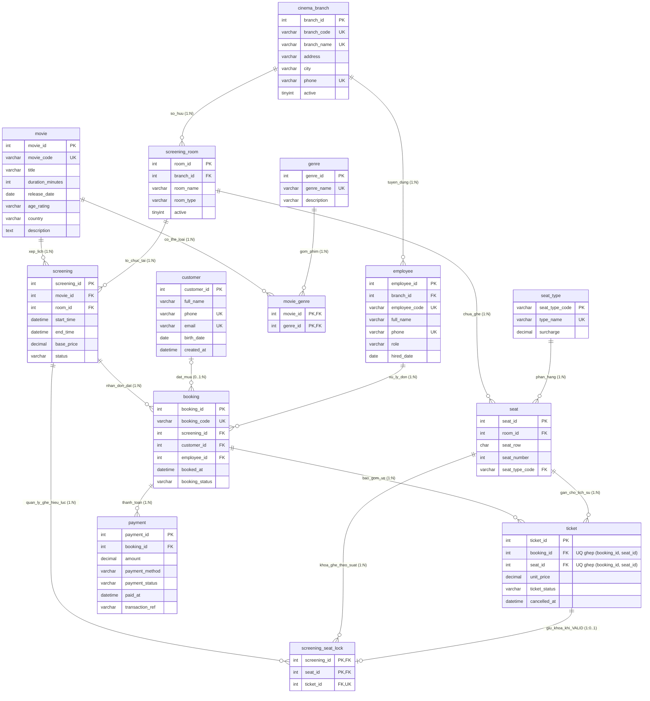

# MÔ HÌNH THỰC THỂ – LIÊN KẾT (ENTITY-RELATIONSHIP DIAGRAM)
**(Tài liệu đáp ứng Tiêu chí R2 — 2.5 điểm)**

---

## 1. Tổng quan Sơ đồ Thực thể – Liên kết (ERD)

Mô hình Thực thể – Liên kết của **Hệ thống Quản lý Chuỗi Rạp Chiếu Phim** được xây dựng gồm **12 tập thực thể nghiệp vụ chính**, **01 thực thể kết hợp phân loại phim (`movie_genre`)** và **01 thực thể kết hợp cấp phát ghế hiệu lực (`screening_seat_lock`)**, tương ứng với **14 bảng quan hệ** trong lược đồ 3NF hiện có.

Đặc biệt, trong mô hình ERD và lược đồ quan hệ chuẩn 3NF:
- Thực thể **`Ticket` (`ticket`)** liên kết với **`Screening` (`screening`)** thông qua **`Booking` (`booking`)**, **không** tạo liên kết dư thừa trực tiếp `screening -> ticket` nhằm triệt tiêu hoàn toàn phụ thuộc hàm bắc cầu $\text{ticket\_id} \to \text{booking\_id} \to \text{screening\_id}$.
- Thực thể kết hợp **`ScreeningSeatLock` (`screening_seat_lock`)** biểu diễn trạng thái cấp phát ghế đang có hiệu lực (`VALID`) của một tấm vé trên cặp `(screening_id, seat_id)`, vừa bảo toàn lịch sử mọi lần hủy vé/đặt lại ghế trong `ticket`, vừa đảm bảo tại mọi thời điểm mỗi ghế trong một suất chiếu chỉ gắn với tối đa một vé hợp lệ ngay ở mức khóa chính CSDL.

Hệ thống cung cấp đồng thời:
1. **Sơ đồ Thực thể – Liên kết (ERD Chen):** Bản vẽ gốc có thể chỉnh sửa tại `docs/erd/erd-chen.drawio`, bản xuất PDF tại `docs/erd/ERD_Chen_A1.pdf`, ảnh kết xuất tại `docs/erd/erd-chen.png` và `docs/erd/erd-chen.svg`. Sơ đồ sử dụng hình chữ nhật tô màu phân nhóm cho 14 thực thể (`CHI_NHANH_RAP`, `PHONG_CHIEU`...), 17 hình thoi mối kết hợp (`SO_HUU`, `QUAN_LY_NV`...), 76 hình elip thuộc tính (gạch chân in đậm thuộc tính khóa chính), đường nét đơn cho tham gia bộ phận và đường nét đôi cho tham gia toàn phần kèm nhãn lực lượng `1` / `N`.
2. **Sơ đồ Lược đồ Quan hệ (Relational Schema):** Bản vẽ gốc tại `docs/erd/luoc-do-quan-he.drawio` (đồng bộ tại `docs/erd/erd-logical.drawio`), bản xuất PDF tại `docs/erd/Data_Diagram_A3.pdf` (`docs/erd/luoc-do-quan-he.pdf`), ảnh kết xuất tại `docs/erd/luoc-do-quan-he.png` và `docs/erd/luoc-do-quan-he.svg`. Mỗi bảng quan hệ được biểu diễn dạng thanh ngang gồm các ô thuộc tính, khóa chính (`PK`) gạch chân nét liền, khóa ngoại (`FK`) gạch chân nét đứt và 17 mũi tên cong tham chiếu trực tiếp từ `PK` tới `FK`.
3. **Sơ đồ Mermaid ER và PlantUML đối chiếu cấu trúc DDL:** Mã nguồn tại `docs/erd/erd-chen.puml`, `docs/erd/erd-logical.puml` và sơ đồ Mermaid trực quan dưới đây.

---

### Cách đọc và phạm vi ràng buộc

- Mô hình E–R biểu diễn tường minh **12 tập thực thể nghiệp vụ chính** cùng **02 tập thực thể trung gian/kết hợp** (`PHIM_THE_LOAI` / `movie_genre` và `KHOA_GHE_SUAT_CHIEU` / `screening_seat_lock`), ánh xạ tương ứng 1–1 sang **14 bảng quan hệ** chuẩn 3NF.
- Theo quy ước bài giảng Cơ sở dữ liệu, mỗi thực thể được vẽ bằng hình chữ nhật, mối kết hợp là hình thoi, thuộc tính là hình elip nối với thực thể, và thuộc tính khóa chính được in đậm gạch chân. Nhãn `1` và `N` thể hiện lực lượng liên kết; **đường nét đôi** biểu diễn sự tham gia toàn phần (bắt buộc), **đường nét đơn** biểu diễn sự tham gia bộ phận (tùy chọn). Ví dụ: `CHI_NHANH_RAP` (**1**) — `SO_HUU` — (**N**) `PHONG_CHIEU`: phía `PHONG_CHIEU` dùng đường nét đôi vì mỗi phòng chiếu bắt buộc phải thuộc về một chi nhánh xác định.
- Đối với quy tắc **BR-08** (`DON_DAT_VE` **1** — `BAO_GOM_VE` — **N** `VE_XEM_PHIM`): cả hai phía đều dùng đường nét đôi vì một đơn đặt vé hoàn chỉnh bắt buộc phải có ít nhất một vé và mỗi tấm vé thuộc về duy nhất một đơn đặt vé (`BookingService.validateBookingRequest()` kiểm tra danh sách ghế không rỗng và `createBooking()` ghi nhận đơn cùng danh sách vé trong một giao dịch nguyên tử).
- Đối với các thực thể danh mục và hạ tầng (`CHI_NHANH_RAP`, `PHONG_CHIEU`, `PHIM`, `THE_LOAI`): một chi nhánh mới thành lập có thể chưa tạo phòng chiếu hoặc nhân viên; một bộ phim mới cập nhật có thể chưa gắn thể loại hoặc chưa xếp suất chiếu, nên các đầu nối phía thực thể cha này được biểu diễn bằng đường nét đơn (tham gia bộ phận).
- Trên **Sơ đồ Lược đồ quan hệ** (`Data_Diagram_A3.pdf` / `luoc-do-quan-he.pdf`), mỗi quan hệ là một thanh ngang gồm các ô thuộc tính: thuộc tính khóa chính (`PK`) in đậm gạch chân nét liền, thuộc tính khóa ngoại (`FK`) gạch chân nét đứt, thuộc tính vừa tham gia khóa chính vừa là khóa ngoại (`PHIM_THE_LOAI(MaPhim, MaTL)` và `KHOA_GHE_SUAT_CHIEU(MaSC, MaGhe)`) có cả gạch chân nét liền và nét đứt, kèm 17 mũi tên cong đi từ ô khóa chính (`PK`) tới ô khóa ngoại (`FK`) tương ứng.
- Quan hệ `VE_XEM_PHIM` (`ticket`) không tạo khóa ngoại trực tiếp tới `SUAT_CHIEU` (`screening`) mà suy diễn bảo toàn qua `DON_DAT_VE` (`ticket.booking_id → booking.screening_id`). Quan hệ `KHOA_GHE_SUAT_CHIEU` (`screening_seat_lock`) có 3 khóa ngoại tham chiếu tới suất chiếu, ghế và vé kèm ràng buộc `UNIQUE(ticket_id)`. Hệ thống Trigger đảm bảo chỉ vé đang `VALID` mới giữ một dòng khóa ghế và tự động giải phóng ngay khi vé chuyển sang `CANCELLED`.
- Cột sinh vật lý `payment.active_success_booking` trong MySQL 8.4 chỉ phục vụ chỉ mục duy nhất có điều kiện cho giao dịch `SUCCESS` ở tầng lưu trữ vật lý, không phải thuộc tính nghiệp vụ trên sơ đồ E–R và lược đồ quan hệ logic.
- Công cụ kiểm chứng tĩnh `python -X utf8 -B tools/verify_erd.py` đối chiếu tự động tính nhất quán giữa tệp `.drawio`, `.svg`, `.puml` và DDL SQL (`01_schema.sql`, `01b_foreign_keys.sql`).

## 2. Thuyết minh Chi tiết 14 Tập Thực thể & Thực thể Kết hợp (Entities)

*(Lưu ý học thuật: Cột "Khóa dự tuyển khác (Alternate Keys)" dưới đây chỉ liệt kê các khóa tối thiểu định danh duy nhất trên **toàn bộ các bộ (rows)** của quan hệ; các biểu thức chỉ mục có điều kiện trên tập con trạng thái không phải khóa dự tuyển của quan hệ).*

| STT | Tên trên Sơ đồ (`ERD` / `Lược đồ QH`) | Tên Bảng Vật lý (`SQL`) | Khóa chính (`PK`) | Khóa dự tuyển khác trên toàn bảng (`Alternate Keys`) | Giải thích Ý nghĩa Nghiệp vụ |
|---:|---|---|---|---|---|
| 1 | `CHI_NHANH_RAP` | `cinema_branch` | `MaCN` (`branch_id`) | `branch_code`, `branch_name`, `phone` | Đại diện cho một cụm rạp chiếu phim thuộc chuỗi rạp đặt tại một địa điểm/thành phố cụ thể. |
| 2 | `PHONG_CHIEU` | `screening_room` | `MaPhong` (`room_id`) | `(branch_id, room_name)` | Không gian chiếu phim vật lý thuộc một chi nhánh rạp, phân loại theo công nghệ `2D`, `3D`, `IMAX`. |
| 3 | `HANG_GHE` | `seat_type` | `MaHangGhe` (`seat_type_code`) | `type_name` | Danh mục phân hạng ghế (`STD` – Ghế Thường, `VIP` – Ghế VIP, `COUPLE` – Ghế Đôi) và phụ thu chuẩn (`surcharge`). |
| 4 | `GHE` | `seat` | `MaGhe` (`seat_id`) | `(room_id, seat_row, seat_number)` | Vị trí chỗ ngồi cố định trong một phòng chiếu, xác định bởi hàng ghế (`A`..`H`) và số thứ tự ghế. |
| 5 | `PHIM` | `movie` | `MaPhim` (`movie_id`) | `movie_code` | Tác phẩm điện ảnh được đưa vào khai thác thương mại với thời lượng (`duration_minutes`) và độ tuổi giới hạn (`age_rating`). |
| 6 | `THE_LOAI` | `genre` | `MaTL` (`genre_id`) | `genre_name` | Danh mục thể loại điện ảnh phục vụ phân loại và tìm kiếm phim. |
| 7 | `PHIM_THE_LOAI` | `movie_genre` | `(MaPhim, MaTL)` (`movie_id, genre_id`) | — | Thực thể kết hợp giải quyết mối quan hệ $M:N$ giữa Phim và Thể loại. |
| 8 | `SUAT_CHIEU` | `screening` | `MaSC` (`screening_id`) | — | Một lịch trình chiếu cụ thể của một bộ phim tại một phòng chiếu trong khoảng thời gian `[start_time, end_time)` với mức giá cơ sở `base_price`. |
| 9 | `KHACH_HANG` | `customer` | `MaKH` (`customer_id`) | `phone`, `email` | Khách hàng đăng ký thành viên của chuỗi rạp để lưu lịch sử mua vé và nhận thông tin. |
| 10 | `NHAN_VIEN` | `employee` | `MaNV` (`employee_id`) | `employee_code`, `phone` | Nhân sự làm việc tại chi nhánh rạp gồm Thu ngân (`CASHIER`), Quản lý chi nhánh (`MANAGER`) và Kế toán (`ACCOUNTANT`). |
| 11 | `DON_DAT_VE` | `booking` | `MaDDV` (`booking_id`) | `booking_code` | Phiên giao dịch đặt mua một hoặc nhiều vé cho một suất chiếu xác định (do khách thành viên hoặc khách vãng lai thực hiện). |
| 12 | `VE_XEM_PHIM` | `ticket` | `MaVe` (`ticket_id`) | `(booking_id, seat_id)` | Tấm vé cụ thể gán một ghế (`seat_id`) trong một đơn đặt vé (`booking_id`) với đơn giá lịch sử `unit_price` và trạng thái `VALID` / `CANCELLED`. Suất chiếu được xác định qua `booking` để đảm bảo chuẩn 3NF. |
| 13 | `KHOA_GHE_SUAT_CHIEU` | `screening_seat_lock` | `(MaSC, MaGhe)` (`screening_id, seat_id`) | `MaVe` (`ticket_id`) | Thực thể kết hợp lưu sự phân bổ ghế đang có hiệu lực (`VALID`) của tấm vé `ticket_id` trên cặp `(screening_id, seat_id)`. Khi vé bị hủy (`CANCELLED`), bản ghi khóa ghế được giải phóng để cho phép bán lại ghế đó cho đơn mới. |
| 14 | `THANH_TOAN` | `payment` | `MaTT` (`payment_id`) | — | Bản ghi giao dịch thanh toán cho đơn đặt vé (`PENDING`, `SUCCESS`, `FAILED`, `REFUNDED`). Ràng buộc tối đa 01 giao dịch `SUCCESS` cho mỗi `booking_id` là ràng buộc duy nhất trên tập con trạng thái, thực thi ở mức vật lý. |

---

## 3. Thuyết minh Chi tiết Các Mối Quan hệ và Bản số (Relationships & Cardinalities)

Các mối kết hợp dưới đây đối chiếu đồng bộ giữa ký hiệu lực lượng `1 : N` kèm nét đơn/nét đôi trên **Sơ đồ E–R (Chen)** và các ràng buộc khóa ngoại trên **Lược đồ quan hệ / SQL**:

1. **`CHI_NHANH_RAP` (`cinema_branch`) (1) — `SO_HUU` — (N) `PHONG_CHIEU` (`screening_room`):**
   - Một chi nhánh có thể chưa có phòng chiếu hoặc sở hữu nhiều phòng chiếu (nét đơn). Mỗi phòng chiếu bắt buộc thuộc về duy nhất một chi nhánh (`MaCN` / `branch_id NOT NULL`, nét đôi).
2. **`CHI_NHANH_RAP` (`cinema_branch`) (1) — `QUAN_LY_NV` — (N) `NHAN_VIEN` (`employee`):**
   - Một chi nhánh có thể chưa có nhân viên hoặc quản lý nhiều nhân viên (nét đơn); mỗi nhân viên làm việc tại một chi nhánh xác định (`MaCN` / `branch_id NOT NULL`, nét đôi).
3. **`PHONG_CHIEU` (`screening_room`) (1) — `CHUA_GHE` — (N) `GHE` (`seat`):**
   - Phòng chiếu có thể chưa lắp ghế hoặc chứa nhiều ghế (nét đơn); mỗi ghế vật lý thuộc duy nhất một phòng chiếu (`MaPhong` / `room_id NOT NULL`, nét đôi).
4. **`HANG_GHE` (`seat_type`) (1) — `PHAN_HANG` — (N) `GHE` (`seat`):**
   - Một hạng ghế (`STD`, `VIP`, `COUPLE`) áp dụng cho nhiều ghế (nét đơn); mỗi ghế vật lý có đúng một hạng ghế (`MaHangGhe` / `seat_type_code NOT NULL`, nét đôi).
5. **`PHIM` (`movie`) (1) — `CO_THE_LOAI` — (N) `PHIM_THE_LOAI` (`movie_genre`) & `THE_LOAI` (`genre`) (1) — `GOM_PHIM` — (N) `PHIM_THE_LOAI`:**
   - Biểu diễn mối quan hệ nhiều – nhiều ($M:N$) giữa Phim và Thể loại. Mỗi dòng trong `PHIM_THE_LOAI(MaPhim, MaTL)` tham chiếu bắt buộc tới một bộ phim và một thể loại (nét đôi ở phía `PHIM_THE_LOAI`).
6. **`PHIM` (`movie`) (1) — `XEP_LICH` — (N) `SUAT_CHIEU` (`screening`):**
   - Một bộ phim có thể có nhiều suất chiếu (nét đơn); mỗi suất chiếu trình chiếu đúng một bộ phim (`MaPhim` / `movie_id NOT NULL`, nét đôi).
7. **`PHONG_CHIEU` (`screening_room`) (1) — `TO_CHUC_TAI` — (N) `SUAT_CHIEU` (`screening`):**
   - Một phòng chiếu tổ chức nhiều suất chiếu theo các khung giờ không giao nhau (nét đơn); mỗi suất chiếu diễn ra tại duy nhất một phòng chiếu (`MaPhong` / `room_id NOT NULL`, nét đôi).
8. **`KHACH_HANG` (`customer`) (1) — `DAT_MUA` — (N) `DON_DAT_VE` (`booking`):**
   - Một khách hàng thành viên có thể đặt nhiều đơn vé. Ngược lại, một đơn đặt vé có thể thuộc về một khách hàng thành viên (`MaKH` / `customer_id` khác `NULL`) hoặc là **Khách vãng lai mua tại quầy** (`customer_id IS NULL`), do đó cả hai phía đều tham gia bộ phận (nét đơn).
9. **`NHAN_VIEN` (`employee`) (1) — `LAP_DON` — (N) `DON_DAT_VE` (`booking`):**
   - Một nhân viên thu ngân lập nhiều đơn đặt vé (nét đơn); mỗi đơn đặt vé được ghi nhận bởi đúng một nhân viên phụ trách (`MaNV` / `employee_id NOT NULL`, nét đôi).
10. **`SUAT_CHIEU` (`screening`) (1) — `CO_DON_DAT` — (N) `DON_DAT_VE` (`booking`):**
    - Một suất chiếu có thể có nhiều đơn đặt vé (nét đơn); mỗi đơn đặt vé đặt chỗ cho đúng một suất chiếu xác định (`MaSC` / `screening_id NOT NULL`, nét đôi).
11. **`DON_DAT_VE` (`booking`) (1) — `BAO_GOM_VE` — (N) `VE_XEM_PHIM` (`ticket`) & `GHE` (`seat`) (1) — `GAN_CHO_VE` — (N) `VE_XEM_PHIM` (`ticket`):**
    - Theo quy tắc **BR-08**, mỗi đơn đặt vé hoàn chỉnh bao gồm ít nhất một vé và mỗi vé thuộc đúng một đơn (cả hai phía `DON_DAT_VE` và `VE_XEM_PHIM` đều dùng nét đôi). Mỗi vé gắn với một ghế vật lý `MaGhe` (`seat_id`), chỉ xuất hiện tối đa một lần trong cùng đơn (`UNIQUE(booking_id, seat_id)`).
12. **`SUAT_CHIEU` (1) — `KHOA_THEO_SUAT` — (N) `KHOA_GHE_SUAT_CHIEU`, `GHE` (1) — `GIU_CHO_GHE` — (N) `KHOA_GHE_SUAT_CHIEU` & `VE_XEM_PHIM` (1) — `GIU_KHOA_GHE` — (1) `KHOA_GHE_SUAT_CHIEU` (`screening_seat_lock`):**
    - Mỗi tấm vé đang ở trạng thái hợp lệ (`ticket_status = 'VALID'`) giữ đúng `1` bản ghi trong `KHOA_GHE_SUAT_CHIEU` (`UNIQUE(ticket_id)`), còn vé đã hủy (`CANCELLED`) có `0` bản ghi.
    - Khóa chính `PRIMARY KEY (screening_id, seat_id)` của `screening_seat_lock` đảm bảo tại mọi thời điểm chỉ có tối đa **01 vé `VALID`** chiếm giữ một ghế trong một suất chiếu, không cần lưu dư thừa `screening_id` bên trong bảng `ticket`.
13. **`DON_DAT_VE` (`booking`) (1) — `PHAT_SINH_TT` — (N) `THANH_TOAN` (`payment`):**
    - Một đơn đặt vé có thể có một hoặc nhiều giao dịch thanh toán theo thời gian (ví dụ: lần 1 thẻ lỗi `FAILED`, lần 2 thành công `SUCCESS`). Mỗi giao dịch thuộc đúng một đơn đặt vé (`MaDDV` / `booking_id NOT NULL`, nét đôi). Ràng buộc duy nhất có điều kiện ở tầng vật lý đảm bảo mỗi đơn chỉ có tối đa **01 giao dịch ở trạng thái `SUCCESS`**.
