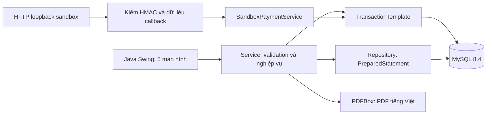

# Báo cáo đánh giá kiến trúc, chất lượng database và mức đáp ứng đồ án

**Dự án:** Hệ thống quản lý chuỗi rạp chiếu phim và đặt vé trực tuyến.  
**Ngày đánh giá:** 15/11/2026, múi giờ UTC+07.  
**Commit được đọc:** `07ba4d33f6a3f19c4b011c6f0577ffb6338b9db6`.  
**Phạm vi:** phân tích và kiểm chứng chỉ đọc; không sửa mã ứng dụng, SQL, cấu hình, trạng thái TASKS hoặc traceability; không chạy migration, setup, seed hay kiểm thử ghi dữ liệu.

## 1. Kết luận điều hành

Thiết kế logic 14 bảng có cơ sở học thuật rõ ràng và đáp ứng cấu trúc của đồ án: chuỗi chi nhánh–phòng–ghế, lịch chiếu, đơn–vé–thanh toán, hai màn hình nhập liệu, một màn hình tìm kiếm và hai báo cáo PDF đều đã có. Không có căn cứ từ lần đánh giá này để thay MySQL, thêm bảng chỉ để tăng độ phức tạp, hoặc thiết kế lại toàn bộ hệ thống.

**Chưa đủ căn cứ nghiệm thu toàn bộ bản chạy hiện tại hoặc triển khai đặt vé trực tuyến thật.** Điểm cần xử lý trước tiên là **7 trigger trên `cinema_chain` khác source**, trong khi 12 trigger trên `cinema_chain_test` khớp phần thân source. Bản test và bản demo có cùng số đối tượng nhưng mức bảo vệ nghiệp vụ khác nhau. Quy trình migration hiện có còn lỗi ở nhánh backup và điều kiện dừng theo kết quả kiểm tra.

Các phép đọc thực tế trên MySQL 8.4.0 chưa tìm thấy sai lệch trong 17 chỉ số toàn vẹn đã kiểm tra ở mỗi database. Doanh thu demo **35.375.000,00 VNĐ** khớp giữa view, tổng vé qua SQL độc lập, tổng payment SUCCESS và báo cáo occupancy. Đây là kết quả đối chiếu dữ liệu hiện có, không chứng minh rằng mọi thao tác sai hoặc mọi lịch chạy đồng thời đều bị chặn.

Không xác định phát hiện **Critical** đã được chứng minh. Có vấn đề **High** về sai khác triển khai và an toàn migration; thiếu auth là **High có điều kiện khi mở trực tuyến**. Các nguy cơ concurrency, múi giờ và snapshot được ghi riêng, chưa coi là lỗi đã tái hiện.

## 2. Phương pháp, phạm vi và mức bằng chứng

### 2.1. Skills và agents đã dùng

- ECC `production-audit`: khung rà soát duy nhất cho lượt audit, tập trung bằng chứng cục bộ.
- ECC `mysql-patterns`: đánh giá schema, index, transaction và MySQL 8.4; không áp dụng cú pháp PostgreSQL.
- Ba agent chuyên trách sử dụng vai trò ECC `database-reviewer`, `security-reviewer`, `architect`: lần lượt rà schema/3NF/migration; Java/nghiệp vụ/thanh toán/bảo mật; rubric/UI/PDF/test và bằng chứng.
- Graphify: đọc vocabulary và graph hiện có để định vị luồng, sau đó đối chiếu source. CLI bị Windows Application Control chặn; không tìm cách vượt chính sách, không dựng lại index hay bật backend cloud. Không dùng cạnh graph làm bằng chứng thực thi.

Chi phí backend semantic Graphify trong lượt này: 0 token vì không gọi extraction/LLM; không có phép đo mức tiết kiệm token.

Các skill/vai trò lấy từ bản ECC `2.2.3` cài ở cấp người dùng. Vai trò database-reviewer gốc có nội dung PostgreSQL; chỉ dùng cách đặt câu hỏi kiểm tra chung, còn kết luận kỹ thuật dựa trên MySQL và source thực tế.

### 2.2. Những gì thực sự đã làm

1. Kiểm tra Git trước khi đọc: chỉ có `tools/__pycache__/` chưa theo dõi; giữ nguyên thư mục này.
2. Đọc cấu trúc, 47 tệp Java vận hành, 18 tệp Java kiểm chứng/kiểm thử trong phạm vi rà soát, SQL schema/trigger/view/seed/migration/query, scripts, tài liệu yêu cầu/ERD/quan hệ/chuẩn hóa/demo và cấu hình build. Manifest dấu vân tay nguồn tại `source-hashes.json`; manifest không có nghĩa mọi tài liệu nhị phân đã được kiểm tra từng trang.
3. Đọc cách nạp cấu hình cục bộ và dùng credentials mà không in mật khẩu, không đưa mật khẩu vào CLI. Metadata đầy đủ được đọc bằng tài khoản quản trị cục bộ; quyền app được xác minh bằng chính tài khoản app. Không xuất dữ liệu cá nhân từng dòng vào báo cáo.
4. MySQL ban đầu chưa chạy. Dùng script dự án để khởi động đúng instance, xác minh version/datadir, chỉ thực thi SELECT/SHOW/EXPLAIN. Không chạy `setup.ps1`, `verify_all.ps1`, functional SQL có INSERT/UPDATE, Maven integration tests hoặc GUI có khả năng ghi dữ liệu.
5. Chụp metadata, DDL, thân trigger, index, số dòng; so trigger với source sau khi chuẩn hóa khoảng trắng và hoa/thường; chạy 17 truy vấn toàn vẹn và 4 phép tổng tiền cho mỗi DB; chạy **10 EXPLAIN** trên demo, gồm hai truy vấn bổ sung seat map và overlap qua view.
6. Chạy mới `python -X utf8 -B tools/verify_erd.py`: thành công cho các kiểm tra tĩnh mà script định nghĩa. Lần gọi đầu bằng Python mặc định thất bại ở bước in tiếng Việt do encoding cp1252; giữ cả log thất bại và log chạy UTF-8. Không sửa script để đạt kết quả.
7. Parse 12 XML kiểm thử đã lưu: 95 tests, failures/errors/skipped đều 0, nhưng là kết quả lịch sử ngày 13/11/2026; **không chạy lại 95 test trong audit**.
8. Xem ảnh lưu sẵn của Crow’s Foot ERD và trang đầu hai báo cáo PDF demo. Không coi ảnh cũ là một lần chạy GUI mới; chưa kiểm tra trực quan toàn bộ PDF/DOCX hoặc mọi trang báo cáo.

### 2.3. Nhãn bằng chứng

| Nhãn | Ý nghĩa |
|---|---|
| **LIVE-READ** | Đã thực thi truy vấn chỉ đọc/EXPLAIN hoặc đọc metadata trong lượt này |
| **STATIC** | Xác nhận được từ source, tài liệu hoặc đường gọi; không đồng nghĩa đã tái hiện hành vi |
| **STATIC-CHECK** | Đã chạy công cụ kiểm tra tĩnh, chỉ chứng minh phạm vi assertion của công cụ |
| **HISTORICAL** | Log/XML/ảnh đã lưu từ lần chạy trước |
| **NEEDS-TEST** | Kịch bản có cơ sở cần thực thi ở môi trường thử; chưa khẳng định đã xảy ra |
| **SCOPE-GAP** | Chưa triển khai hoặc chưa đặc tả cho phạm vi online; không tự suy thành lỗi rubric desktop |

Không đổi bất kỳ hạng mục nào thành VERIFIED trong `TASKS.md` hoặc `REQUIREMENTS_TRACEABILITY.md`.

## 3. Kiến trúc hiện tại

### 3.1. Công nghệ và ranh giới lớp

`pom.xml` khai báo Java release 21, FlatLaf 3.5.2, Connector/J 9.1.0, PDFBox 3.0.3, JUnit 5.11.3 và ArchUnit 1.3.0. Phiên bản Connector/J không phải phiên bản server. Server được đọc thực tế là **MySQL Community Server 8.4.0**, InnoDB/utf8mb4, `utf8mb4_unicode_ci`.

Luồng vận hành chính:

`Main` dùng cấu hình production/demo. `SandboxMain` dùng cấu hình test; `SandboxPaymentRepository.assertTestDatabase()` kiểm tra database, tài khoản và phiên bản server trước khi bật callback. Đây là ứng dụng desktop truy cập JDBC trực tiếp, kèm HTTP callback sandbox cục bộ; chưa phải website/backend phục vụ khách Internet.

`TransactionTemplate.java:25–52` tắt autocommit, đặt READ_COMMITTED, commit khi callback thành công, rollback cho SQLException, BusinessRuleException, RuntimeException và Error. Server mặc định REPEATABLE-READ, nhưng transaction đi qua template dùng isolation riêng; không được nhầm hai mức này.

Các kiểm tra ArchUnit ở `src/test/java/com/cinema/architecture/ArchitectureComplianceTest.java` bảo vệ UI không dùng JDBC/repository trực tiếp, backend không phụ thuộc UI và startup không chạy script reset. Audit đọc source cho thấy việc phân tầng là nền tảng tốt; chưa chạy lại ArchUnit trong lượt này.

### 3.2. Môi trường MySQL đã xác minh

| Thuộc tính | Giá trị đọc thực tế |
|---|---|
| Server | MySQL Community Server 8.4.0 |
| Endpoint | `127.0.0.1:3306` |
| Datadir | `C:/Users/LNB/.mysql/data-8.4/` |
| Bind address | `127.0.0.1` |
| Charset/collation | `utf8mb4` / `utf8mb4_unicode_ci` |
| SQL mode | Có STRICT_TRANS_TABLES, ONLY_FULL_GROUP_BY, NO_ZERO_DATE, NO_ZERO_IN_DATE |
| Time zone phiên | `+07:00` |
| Durability | `innodb_flush_log_at_trx_commit=1`, `sync_binlog=1`, `log_bin=ON` |
| Secure transport | `require_secure_transport=OFF`; hiện bind loopback |

Nguồn: `instance.tsv`. Không thay đổi các biến server. Thông số durability không thay thế kiểm thử crash/restore hay đảm bảo chống mất điện của toàn bộ phần cứng.

`app-grants.tsv` xác nhận `cinema_app` có SELECT/INSERT/UPDATE/DELETE/EXECUTE/SHOW VIEW trên demo, không có CREATE/DROP/ALTER/TRIGGER trên demo. Trên test, cùng app user có thêm quyền DDL phục vụ fixtures. Đây là tách quyền demo/test có chủ đích; quyền này không phải cơ chế phân quyền từng người dùng Swing.

### 3.3. Inventory vật lý thực tế

| Đối tượng | Source | `cinema_chain` | `cinema_chain_test` |
|---|---:|---:|---:|
| BASE TABLE | 14 | 14 | 14 |
| PRIMARY KEY | 14 | 14 | 14 |
| FOREIGN KEY | 17 | 17 | 17 |
| UNIQUE ngoài PK | 16 | 16 | 16 |
| CHECK | 19 | 19 | 19 |
| INDEX thường | 14 | 14 | 14 |
| Tổng index, gồm PK/UQ | 44 | 44 | 44 |
| TRIGGER | 12 | 12 | 12 |
| VIEW | 4 | 4 | 4 |
| Thân trigger khác source | — | **7** | **0** |

Số lượng không chứng minh đồng nhất định nghĩa. So sánh trigger chỉ chuẩn hóa khoảng trắng và hoa/thường của phần thân, không phải một hệ thống quản lý schema version đầy đủ. Đối chiếu metadata cột/ràng buộc/index/CHECK/FK giữa hai schema, bỏ riêng tên schema, cũng cho kết quả bằng nhau (`structural-comparison.json`); phần thân trigger vẫn khác. DDL, kiểu cột, NULL, generated expression, tên từng ràng buộc, index và hành vi FK được lưu trong `SCHEMA-INVENTORY.md`, `columns.tsv`, `constraints.tsv`, `checks.tsv`, `foreign_keys.tsv`, `indexes.tsv`, `*-show-create.tsv`.

### 3.4. Mười bốn bảng và khóa

| Bảng | PK | Khóa UNIQUE khác | Dòng demo / test |
|---|---|---|---:|
| cinema_branch | branch_id | branch_code; branch_name; phone | 4 / 4 |
| screening_room | room_id | (branch_id, room_name) | 12 / 12 |
| seat_type | seat_type_code | type_name | 3 / 3 |
| seat | seat_id | (room_id, seat_row, seat_number) | 960 / 960 |
| movie | movie_id | movie_code | 20 / 20 |
| genre | genre_id | genre_name | 8 / 8 |
| movie_genre | (movie_id, genre_id) | — | 43 / 43 |
| screening | screening_id | — | 161 / 160 |
| customer | customer_id | phone; email | 45 / 45 |
| employee | employee_id | employee_code; phone | 12 / 12 |
| booking | booking_id | booking_code | 162 / 160 |
| ticket | ticket_id | (booking_id, seat_id) | 376 / 373 |
| screening_seat_lock | (screening_id, seat_id) | ticket_id | 329 / 327 |
| payment | payment_id | active_success_booking, cột sinh có điều kiện | 177 / 175 |

Nguồn DDL: `database/schema/01_schema.sql:23,41,56,69,85,103,114,124,143,158,177,200,222,238`. Số dòng: `row-counts.json`. Khác biệt số dòng demo–test phù hợp với database có lịch sử vận hành riêng; không phải căn cứ để reset demo.

17 FK được nhóm như sau:

- screening_room → cinema_branch; seat → screening_room và seat_type.
- movie_genre → movie và genre; screening → movie và screening_room.
- employee → cinema_branch; booking → screening, customer và employee.
- ticket → booking và seat; screening_seat_lock → screening, seat và ticket.
- payment → booking.

`booking.customer_id` nullable cho khách vãng lai; xóa customer đặt NULL. Xóa movie cascade vào movie_genre, xóa ticket cascade vào lock. Phần lớn quan hệ dùng DELETE RESTRICT. Payment→booking dùng UPDATE RESTRICT vì booking_id là đầu vào cột sinh STORED. Cần nhớ cascade FK của MySQL không kích hoạt trigger; không được dựa vào trigger con để kiểm soát một thay đổi cascade chưa được thiết kế/test. Xem [MySQL 8.4 — FOREIGN KEY](https://dev.mysql.com/doc/refman/8.4/en/create-table-foreign-keys.html).

### 3.5. CHECK, VIEW và TRIGGER

19 CHECK bao phủ cờ active, loại phòng, mã hạng ghế, phụ thu, tọa độ ghế, thời lượng/phân loại phim, giá/thời gian/trạng thái suất, vai trò nhân viên, trạng thái đơn/vé và số tiền/phương thức/trạng thái payment. CHECK không thay thế ràng buộc liên bảng hoặc kiểm tra toàn bộ state machine.

| View | Nguồn | Mục đích |
|---|---|---|
| vw_screening_search | `03_views.sql:19` | Lịch chiếu, sức chứa, ghế đã giữ và ghế trống |
| vw_verified_booking_revenue | `03_views.sql:58` | Vé VALID + đơn CONFIRMED + payment SUCCESS |
| vw_branch_daily_revenue | `03_views.sql:114` | Tổng hợp doanh thu theo ngày thanh toán/chi nhánh |
| vw_screening_occupancy | `03_views.sql:137` | Vé đã bán, tỷ lệ lấp đầy, ghế trống vật lý và doanh thu theo suất |

| Trigger | Source `02_triggers.sql` | Thân demo so source |
|---|---:|---|
| trg_screening_validate_ins | 34 | Khác |
| trg_screening_validate_upd | 88 | Khác |
| trg_booking_validate_upd | 170 | Khác |
| trg_ticket_validate_ins | 223 | Khác |
| trg_ticket_validate_upd | 273 | Khác |
| trg_ticket_lock_after_ins | 323 | Khớp sau chuẩn hóa |
| trg_ticket_lock_after_upd | 342 | Khớp sau chuẩn hóa |
| trg_ssl_validate_ins | 374 | Khớp sau chuẩn hóa |
| trg_ssl_validate_upd | 402 | Khớp sau chuẩn hóa |
| trg_ssl_validate_del | 430 | Khớp sau chuẩn hóa |
| trg_payment_validate_ins | 449 | Khác |
| trg_payment_validate_upd | 483 | Khác |

Chi tiết diff thật nằm ở `trigger-diff.md`; metadata nguyên bản ở `cinema_chain-triggers.tsv` và `cinema_chain_test-triggers.tsv`.

## 4. Review ERD, mô hình quan hệ và 3NF

### 4.1. Kết quả học thuật

Đọc `docs/erd/`, `docs/relational-model/schema-design.md`, `docs/normalization/normalization.md` và source DDL cho thấy quan hệ nhiều rạp được mô hình hóa hợp lý. `movie_genre` giải quyết N–N, `screening_room.branch_id` và `seat.room_id` xác định phạm vi sở hữu, UNIQUE tên phòng theo chi nhánh và tọa độ theo phòng tránh nhầm các phòng/ghế cùng tên giữa rạp.

Với tập phụ thuộc hàm đã phát biểu, **không phát hiện vi phạm 3NF logic có căn cứ**. Kết luận này dựa trên ngữ nghĩa nghiệp vụ và khóa, không phải chỉ vì có 14 bảng hoặc vì dữ liệu mẫu chưa lặp.

- Các quan hệ danh mục: PK và các alternate key NOT NULL UNIQUE xác định các thuộc tính còn lại. Không lưu lặp tên chi nhánh ở employee/room hoặc tên hạng ghế ở seat.
- `movie_genre(movie_id, genre_id)` không có FD không tầm thường được công bố; cả cặp là khóa.
- `screening_id → movie_id, room_id, start_time, end_time, base_price, status`. `(room_id,start_time)` không là khóa toàn lịch sử vì suất CANCELLED và suất lập lại có thể cùng giờ. Không tự suy `end_time` từ movie/start_time vì thời gian đệm linh hoạt.
- `booking_id` và `booking_code` là các khóa; `screening_id` đặt ở booking vì một đơn thuộc đúng một suất.
- `ticket` có hai khóa `{ticket_id}` và `{booking_id,seat_id}`. Bỏ screening_id loại được FD bắc cầu/bộ phận `booking_id → screening_id` trong quan hệ ticket cũ.
- `unit_price` là giá chốt lịch sử; không phải bản sao cần đồng bộ theo giá hiện hành. Không xóa cột này để “chuẩn hóa”.
- `screening_seat_lock` có khóa `{screening_id,seat_id}` và `{ticket_id}`; mọi thuộc tính đều là thuộc tính khóa. Đây là tập cấp phát đang hiệu lực materialize để cưỡng chế không trùng ghế, cần cơ chế đồng bộ nhưng không làm ticket mất 3NF.
- `payment` logic có khóa toàn bảng `payment_id`. Unique cột sinh nullable chỉ cưỡng chế tối đa một SUCCESS/booking, không phải alternate key của toàn bảng. Không tự coi `transaction_ref` nullable là candidate key.

### 4.2. Lossless join và bảo toàn FD

Phép tách ticket cũ thành `R_ticket(ticket_id, booking_id, seat_id, unit_price, ticket_status, cancelled_at)` và `R_bs(booking_id, screening_id)` có phần giao `{booking_id}`; phần giao xác định toàn bộ `R_bs`. Vì vậy phép tách này lossless theo FD đã cho. `R_bs` đã nằm trong booking hiện có. Tài liệu `normalization.md:55–73` giới hạn đúng kết luận cho phép tách vé, không giả định đã chứng minh một quan hệ phổ quát cho cả 14 bảng.

Kiểm tra mới bằng `verify_erd.py` xác nhận 14 thực thể, thuộc tính/kiểu/NULL/PK/FK/UQ, 17 liên kết và bản số Chen/Crow’s Foot/Mermaid; kiểm draw.io/SVG và bao đóng 128 tập con của mô hình ticket cũ. Log: `erd-static-check-utf8.log`. Đây là **STATIC-CHECK**, không phải bằng chứng toàn bộ trigger/FD nghiệp vụ chạy đúng.

Chen yêu cầu đơn hoàn chỉnh có ít nhất một vé; Crow’s Foot phản ánh DDL cho phép tạm thời 0 vé khi đang lập đơn. Khác biệt đã giải thích trong `docs/erd/erd-correctness-proof.md`; không ghi nhầm là lỗi ERD chưa giải quyết.

### 4.3. Quan hệ thiếu hoặc dư thừa

Không thấy bảng cần bỏ hoặc quan hệ lõi cần thêm để đáp ứng rubric desktop đã mô tả. Không cần thêm CRUD phim/khách hàng chỉ để đủ “hai màn hình nhập liệu”.

Đối với sản phẩm online thật, còn thiếu ranh giới danh tính, quyền sở hữu đơn, phân quyền vận hành, đối soát/hoàn tiền cổng thật. Đây là yêu cầu mở rộng cần chốt trước khi thiết kế thêm, không phải lý do tự ý sửa mô hình học thuật 14 bảng trong audit.

## 5. Review nghiệp vụ và bảo mật

### 5.1. Cơ chế đã có trong source

| Nghiệp vụ | Cơ chế và bằng chứng | Giới hạn kết luận |
|---|---|---|
| Chống bán trùng ghế | `BookingService.java:132–178` khóa screening, kiểm từng ghế rồi ghi một transaction; PK lock `(screening_id,seat_id)` là chốt uniqueness | Source tốt; chưa chạy lại race |
| Chống trùng lịch | `ScreeningService.java:129–151,167–204`, repository khóa phòng/chi nhánh, overlap theo hai bất đẳng thức giao khoảng | Trigger demo còn bản cũ; xem H01 |
| Giá vé | BigDecimal, base_price+surcharge, ghi unit_price lịch sử | Trigger demo chưa cấm sửa giá lịch sử |
| Đặt và thanh toán tại quầy | Booking/ticket/payment ghi cùng transaction; rollback khi lỗi | SUCCESS tại quầy là trạng thái do người vận hành chọn, không phải bằng chứng thu tiền từ cổng |
| Hủy đơn/bán lại | `BookingRepository.java:366–413` khóa booking, hủy vé, cập nhật payment, trigger giải phóng lock | Chưa có thao tác hủy một phần/refund một phần hoàn chỉnh ở UI |
| Không nhân đôi doanh thu | VALID/CONFIRMED/SUCCESS, unique một SUCCESS, SQL oracle dùng EXISTS | Chưa chứng minh mọi thay đổi trực tiếp sau thanh toán bị chặn |
| Chống SQL Injection | Giá trị bind bằng PreparedStatement; SQL động ở search/report chỉ nối fragment cố định | Không thấy injection trong đường Java đã đọc; không phải chứng nhận an toàn tuyệt đối |
| Callback sandbox | HMAC-SHA512, so chữ ký constant-time, kiểm merchant/ref/amount/status, chặn tham số lặp và quá dài | Chưa có giao dịch merchant thật |
| Idempotence callback | Khóa booking rồi payment, kiểm trạng thái cuối, xử lý IPN lặp | Có test lịch sử; chưa chạy lại |
| Return URL | Không cập nhật DB để xác nhận thanh toán | Không nhầm redirect trình duyệt với IPN hợp lệ |
| Tiền về muộn | Giữ đơn CANCELLED, ghi VNPAY-LATE để đối soát, không lấy lại ghế | Chưa xử lý refund thật |
| Bảo vệ demo | Main không reset; setup chặn CleanReset, reset chỉ test; sandbox guard test-only | Không đồng nghĩa mọi tài khoản/người dùng đều có quyền nghiệp vụ phù hợp |

### 5.2. Các phát hiện High

#### H01 — Database demo chưa có 7 trigger bảo vệ hiện hành

**Mức:** High. **Bằng chứng:** LIVE-READ + STATIC; tác hại cụ thể khi ghi sai/chạy race chưa tái hiện trong audit.

`trigger-drift.json`, `trigger-diff.md` xác minh trực tiếp các thân trigger khác nhau. Bản demo thiếu những phần sau mà source/test đã có:

- Screening: kiểm đồng thời trạng thái chi nhánh/phòng và locking reads mới cho kiểm tra overlap.
- Booking: chặn kích hoạt lại đơn hủy, kiểm SUCCESS trước chuyển CONFIRMED và đồng bộ các dòng vé/payment khi hủy trực tiếp.
- Ticket: kiểm booking CANCELLED và chặn sửa unit_price đã phát hành.
- Payment: đối chiếu amount với tổng vé VALID, kiểm đơn hủy/tồn tại và khóa booking/ticket khi ghi SUCCESS.

Không khẳng định luồng Swing bình thường đã làm sai dữ liệu: service vẫn có nhiều kiểm tra riêng, và dữ liệu hiện tại không có các sai lệch đã truy vấn. Nhưng kết quả test trên test DB **không thể suy sang các đường SQL của demo**. Tài liệu cũ đã công khai `demo_database_migrated=false` trong `verification/business-audit/result.json`; audit này bổ sung bằng chứng live mới.

**Ưu tiên:** P0 trước nghiệm thu bản demo. Chuẩn bị migration chỉ cập nhật các đối tượng cần thiết cho schema 14 bảng, rehearsal trên clone, so số dòng/nội dung và tính hợp lệ trước/sau. Không dùng reset và không chạy lại migration 13→14 một cách máy móc.

#### H02 — Nhánh sao lưu trước migration gọi helper không tồn tại

**Mức:** High về khả năng phục hồi/vận hành. **Bằng chứng:** STATIC, kiểm tên trong module; không chạy backup/migration.

`tools/db_fingerprint.py:215` gọi `resolve_mysql_bin()`, nhưng module chỉ định nghĩa `resolve_mysql_exe()` tại dòng 31. `backup-static-check.json` xác nhận module không có tên được gọi. `database/migrations/apply_migration_cinema_chain.ps1:48` luôn truyền `--dump-backup` nên sẽ đi vào nhánh lỗi này nếu chạy đến đó.

Script PowerShell kiểm exit code ở dòng 49 và dừng khi backup thất bại: **không có bằng chứng nó lặng lẽ migration không backup**. Vấn đề là đường backup/migration được tài liệu hóa hiện không hoàn chỉnh. Cần sửa và kiểm restore trên clone trước khi dùng làm phương án nâng cấp; không chỉ chứng minh có file dump.

#### H03 — Precheck/postcheck migration không assert chỉ số nghiệp vụ

**Mức:** High, là điều kiện an toàn còn thiếu; hiện có thể bị che bởi H02. **Bằng chứng:** STATIC.

`apply_migration_cinema_chain.ps1:53–54,65–66` chỉ kiểm `$LASTEXITCODE`. `V2_3nf_ticket_precheck.sql:19` trở đi và `verification/verify_constraints.sql` trả số lỗi bằng SELECT; SQL trả count khác 0 vẫn có thể kết thúc exit 0. Dòng 72 của apply in COMPLETED dựa trên exit code.

Sau khi sửa backup, script vẫn có thể đi tiếp khi mismatch/duplicate/wrong_room được in ra. Forward migration còn DROP nhiều trigger và thực hiện nhiều DDL (`V2_3nf_ticket_up.sql:13–25` trở đi), không có maintenance gate hoặc phục hồi từng chặng. Không thể coi cả chuỗi là một transaction rollback được. Source precheck còn tham chiếu `ticket.screening_id`, chỉ phù hợp schema 13 bảng; **không phải đường nâng cấp trigger cho DB 14 bảng hiện tại**.

**Ưu tiên:** P0/P1 trước thực thi migration: assert kết quả có cấu trúc, dừng khi bất kỳ invariant sai, kiểm version/schema đầu vào, ngừng writer trong cửa sổ bảo trì, thử lỗi tại từng bước và thử restore. Chỉ triển khai khi người vận hành yêu cầu giai đoạn sửa/áp dụng.

#### H04 — Thiếu auth/authorization cho phạm vi khách truy cập Internet

**Mức:** High **nếu mở trực tuyến**, SCOPE-GAP. Không tự kết luận trượt rubric desktop.

`Main.java:18–21` mở AppShell trực tiếp; `AppShell.java:64–88,132–141` tạo và cho truy cập tất cả phân hệ; `TicketBookingPanel.java:451–467` cho chọn nhân viên/trạng thái thu tiền; service nhận ID nhưng không có principal/session/ownership của người gọi. Employee.role là dữ liệu danh mục, chưa là một cơ chế thực thi quyền.

Kiến trúc hiện tại phù hợp demo desktop tin cậy. Nếu đưa cho khách online, cần backend xác thực, kiểm quyền trên server, chủ sở hữu đơn và quyền theo vai trò/chi nhánh; không phân phối tài khoản JDBC dùng chung cho khách. Chốt phạm vi trước, giữ mô hình lõi đơn giản. Chưa thấy public online deployment hay bằng chứng khai thác.

### 5.3. Phát hiện Medium và Low

| ID | Mức | Phát hiện, bằng chứng cụ thể | Phân biệt xác minh/nguy cơ |
|---|---|---|---|
| M01 | Medium | `verify_all.ps1:98–107` chỉ bắt buộc 8 suite cũ, thiếu PaymentRecoveryIT/BusinessRulesIT/SandboxPaymentIT/VnpayGatewayTest. `:184` có thể bỏ SQL thiếu rồi `:195` vẫn báo ALL GATES PASSED | STATIC: gate chưa đủ; không khẳng định lần chạy lịch sử đã thiếu |
| M02 | Medium | JDBC/PDF chạy trên EDT: Main:19–20; AppShell:188,193,203–207; ScreeningManagementPanel:166,170,444,476; TicketBookingPanel:205,437–468,240,516–524; report listeners gọi generate/export trực tiếp | STATIC đường gọi; NEEDS-TEST độ treo khi lock/I/O chậm. Trái quy ước EDT của dự án |
| M03 | Medium | RevenueReportService:58–61 lấy summary và daily bằng hai lần mở connection (`RevenueReportRepository:60,108`) | NEEDS-TEST: writer commit ở giữa có thể làm tổng và chi tiết trong cùng PDF khác snapshot |
| M04 | Medium | BookingService:29–30,161–162 tạo mã theo giây + AtomicInteger cục bộ JVM | STATIC thuật toán; NEEDS-TEST hai JVM cùng lượt/cùng giây có thể trùng mã. UNIQUE gây rollback, không gây hai mã trùng đã lưu |
| M05 | Medium | BookingService:161 dùng LocalDateTime.now mặc định; SandboxPaymentService:83 dùng Clock/Asia_Ho_Chi_Minh; VnpayGateway:31 lấy thời gian tạo đơn | NEEDS-TEST JVM UTC: lệch hạn giữ chỗ/CreateDate. Máy hiện tại UTC+07 chưa chứng minh lỗi đang xảy ra |
| M06 | Medium | BookingService:195–198 → BookingRepository:433–447 xác nhận mọi payment PENDING, không phân biệt marker VNPAY; hợp đồng sandbox-payment.md:7–8 yêu cầu IPN hợp lệ | STATIC thiếu guard ở service; chưa thấy UI/HTTP hiện hữu bypass. Caller vận hành hiện tại đã verify HMAC. Không xếp Critical |
| M07 | Medium | RevenueReportPanel:249–257, TicketSalesReportPanel:253–261 gọi export không bắt BusinessRuleException dù service bọc IOException | STATIC đường lỗi; NEEDS-TEST file khóa/đích không ghi được để kiểm banner tiếng Việt và giữ tệp cũ |
| M08 | Medium | `functional_sql_verification.sql:206` còn WHERE br.active=1; `RevenueReportRepository:42–49` không loại chi nhánh đóng; BR-14 bổ sung giữ doanh thu lịch sử | STATIC drift script/rubric, chưa phải lỗi tổng doanh thu Java. Cần fixture inactive-branch có tiền |
| M09 | Medium khi mở rộng | DATE/TIME trên cột thời gian, LIKE chứa wildcard đầu và correlated COUNT/SUM lặp trong views; EXPLAIN đã cho scan/materialize | LIVE-READ access plan; chưa có benchmark để kết luận chậm hoặc cần thêm index |
| L01 | Low | Bảng chính README/test-plan/traceability còn baseline 40 tests, phần bổ sung nói 95; một số tên test cũ không còn khớp | STATIC sai khác mô tả bản giao; giữ lịch sử và thêm manifest hiện hành |
| L02 | Low | `01_schema.sql:77` kiểm seat_row giữa A và Z dưới collation CI; `collation-check.tsv` cho cả 'a' và 'Á' đều thỏa | LIVE-READ biểu thức; chưa INSERT ghế. Nếu yêu cầu đúng ASCII hoa, CHECK hiện chưa diễn đạt đúng |
| L03 | Low | ScreeningConcurrencyIT:95,98,165,168 dùng await/get không timeout; cleanup theo room/date tại :193–199, BookingConcurrencyIT:265+ tương tự | STATIC: có thể treo hoặc đụng fixture test song song; không có bằng chứng mất dữ liệu demo |
| L04 | Low/khả năng mở rộng | PdfReportWriter:85–105 không ngắt trang phần tổng chi nhánh; drawText:280 không wrap theo chiều rộng; cắt chuỗi bằng số ký tự | STATIC giới hạn layout. Ảnh cũ có tiếng Việt đọc được; cần thử nhiều chi nhánh/tên dài và kiểm mọi trang PDF |

M03 cần một **snapshot đọc nhất quán**. Chỉ đưa hai SELECT vào `TransactionTemplate` hiện tại (READ_COMMITTED) chưa bảo đảm cùng snapshot; cần lựa chọn transaction đọc phù hợp, ví dụ một connection ở REPEATABLE READ và consistent snapshot. MySQL mô tả snapshot theo isolation tại [Transaction Isolation Levels](https://dev.mysql.com/doc/refman/8.4/en/innodb-transaction-isolation-levels.html). Đây là đề xuất thiết kế, chưa sửa code.

### 5.4. Các nguy cơ integrity cần kiểm thử riêng

Các mục dưới đây không được nâng thành “lỗi runtime đã xác minh” chỉ vì có đường đi lý thuyết:

1. **Ticket trực tiếp cạnh tranh với đổi phòng/hủy suất:** trigger ticket khóa booking FOR SHARE (`02_triggers.sql:235,290`) nhưng đọc screening/seat thường (`:242–248,292–298`); trigger sửa screening đếm ticket thường (`:118–134`). Cần hai session giữ snapshot/barrier, xác minh sau commit không có VALID trên suất CANCELLED hoặc ghế sai phòng. Java có khóa screening nên phải kiểm riêng đường Java và SQL trực tiếp.
2. **Thay đổi bộ vé sau payment SUCCESS:** trigger payment đối chiếu tổng lúc ghi SUCCESS; chưa có đầy đủ bất biến bảo vệ mọi INSERT/DELETE/CANCEL/MOVE ticket sau đó. Cần thử thao tác trực tiếp và so `payment.amount` với tổng vé VALID. Đối chiếu hai cách cùng cộng `ticket.unit_price` chưa đủ phát hiện lệch tiền thu.
3. **Sửa quan hệ cha:** cập nhật seat.room_id hoặc movie.duration_minutes có thể làm vé/lịch cũ không còn hợp lệ; không có trigger tương ứng trên hai bảng cha. Giới hạn đã được ghi tại `business-rules.md:45–50`; chỉ nâng thành yêu cầu sửa nếu các thao tác này thuộc phạm vi quản trị được phép.
4. **Deadlock và throughput:** booking tuần tự hóa theo một dòng screening kể cả khi khách mua ghế khác nhau. Đó là lựa chọn đơn giản, an toàn ở quy mô đồ án; cần đo trước khi đổi sang khóa tinh hơn. Deadlock được rollback/thông báo thử lại, chưa có retry tự động. Không xóa khóa chỉ để tối ưu suy đoán.
5. **Thời điểm hủy:** source tự đặt cancelled_at khi CANCELLED nhưng chưa thể coi mọi chuyển trạng thái đều bảo đảm VALID⇒cancelled_at NULL. Dữ liệu hiện tại có 0 trường hợp sai; thêm test transition trước khi thắt constraint.

### 5.5. Hoàn tiền và giới hạn online

Hủy đơn tại quầy chuyển SUCCESS→REFUNDED trong DB là mô hình nghiệp vụ nội bộ; không tự chứng minh tiền đã được trả qua ngân hàng. Nhánh VNPay đã chủ động **chặn hủy tự động SUCCESS** và ghi rõ chưa tích hợp API refund (`BookingRepository.java:380–388`, `docs/requirements/sandbox-payment.md:27–31`). Đây là cách diễn đạt trung thực cần giữ.

Hạn giữ ghế 15 phút chỉ áp dụng đơn VNPAY PENDING. Manual PENDING không tự hết hạn là chủ ý đã ghi trong đặc tả, không báo là bug. Tuổi khách so với phân loại phim, cửa sổ bán trước giờ chiếu, quyền nhân viên theo chi nhánh chưa được đặc tả đầy đủ (`sandbox-payment.md:47–49`). Không tự đặt quy tắc rồi chấm FAIL.

TLS đang tắt trên cấu hình loopback. Nếu chuyển DB/callback qua mạng, cần thiết kế HTTPS/TLS và quản lý secret tương ứng; chưa có bằng chứng môi trường hiện tại đang truyền credentials qua mạng công cộng.

## 6. Kết quả đọc dữ liệu và phân tích hiệu năng

### 6.1. Toàn vẹn dữ liệu hiện có

Hai tệp `cinema_chain-integrity.json` và `cinema_chain_test-integrity.json` lưu kết quả mới. Mỗi database có **0** cho cả 17 nhóm sai lệch sau:

1. Các cặp suất OPEN chồng lấn cùng phòng.
2. Vé có ghế sai phòng so với suất của booking.
3. Nhóm nhiều vé VALID trên cùng suất/ghế.
4. Vé VALID thiếu lock hoặc lock không khớp.
5. Lock không có vé VALID tương ứng.
6. Vé VALID thuộc booking CANCELLED.
7. Vé VALID thuộc screening CANCELLED.
8. Payment SUCCESS có amount khác tổng vé VALID.
9. Payment SUCCESS thuộc booking CANCELLED.
10. Booking CONFIRMED không có đúng một SUCCESS.
11. Booking PENDING nhưng đã có SUCCESS.
12. Booking CONFIRMED không có vé VALID.
13. Vé VALID có cancelled_at.
14. Vé CANCELLED thiếu cancelled_at.
15. SUCCESS thiếu paid_at.
16. Thời lượng suất ngắn hơn phim.
17. Nhóm booking có nhiều payment SUCCESS.

Các truy vấn exact có trong `queries-integrity.json`, không phải toàn bộ hệ thống constraint. Kết quả 0 chỉ xác nhận không tìm thấy các sai lệch này tại thời điểm đọc; không kiểm hết miền dữ liệu, mọi FK orphan theo kiểu bỏ FK trước đó, hoặc mọi trạng thái nghiệp vụ có thể có.

| Tổng tiền đối chiếu toàn dữ liệu | Demo | Test |
|---|---:|---:|
| SUM(view.recognized_revenue) | 35.375.000,00 | 35.165.000,00 |
| SQL độc lập ticket+booking+EXISTS SUCCESS | 35.375.000,00 | 35.165.000,00 |
| SUM(payment.amount WHERE SUCCESS) | 35.375.000,00 | 35.165.000,00 |
| SUM(occupancy.sales_revenue) | 35.375.000,00 | 35.165.000,00 |

Đây là đối soát toàn dữ liệu hiện có, chưa kiểm mọi bộ lọc ngày/chi nhánh hoặc tình huống refund/cancel đồng thời. Doanh thu tính theo ngày thanh toán, báo cáo bán vé lọc theo ngày chiếu; hai báo cáo không bắt buộc bằng nhau nếu chọn cùng khoảng ngày nhưng payment và suất khác kỳ.

### 6.2. Index và EXPLAIN thực tế

44 index/database gồm đầy đủ leftmost prefix cho các FK. Chưa thấy thiếu index FK trong thiết kế; không đề xuất thêm index hàng loạt.

| Truy vấn đại diện | Kết quả EXPLAIN đáng chú ý | Ý nghĩa |
|---|---|---|
| Search chỉ ngày và ghế trống | screening `ALL`, rows estimate 160; derived + filesort; correlated counts dùng index | Có cơ hội cải thiện lọc ngày khi dữ liệu lớn; scan 160 dòng chưa chứng minh chậm |
| Search thêm branch | room dùng uq_room_branch_name; screening dùng idx_screening_room_time, estimate 13/phòng | Bộ lọc branch giúp thu hẹp |
| Search summary | screening ALL; correlated seat/lock counts | Tính tổng có thể tốn hơn một trang hiển thị |
| Overlap bảng screening | range idx_screening_room_time, estimate 1 | Index hiện tại phục vụ giao khoảng |
| Overlap qua view, như repository | range trên screening; thêm derived/correlated counts | Có chi phí tải thông tin nhiều hơn một kiểm EXISTS, cần đo trước khi rút gọn |
| Lookup một khóa ghế | const PRIMARY(screening_id,seat_id), estimate 1 | Đường chốt uniqueness/lookup phù hợp |
| Seat map đầy đủ | screening const; seat ref uq_seat_position; lock eq_ref PRIMARY; sort/temp | Scan 80 ghế/phòng hợp lý; seat_type ALL chỉ 3 dòng không phải lỗi |
| Revenue summary | booking ALL estimate 160; derived/temp; payment dùng idx_payment_booking | View tổng hợp có materialization; cần benchmark với quy mô lớn |
| Daily revenue | derived/grouping + filesort, booking ALL | Không giả định index paid_at đã tối ưu được DATE(paid_at) |
| Sales occupancy | index room/time, nhiều DEPENDENT SUBQUERY, outer filesort | Tổng hợp lặp theo suất là điểm đo ưu tiên khi tăng dữ liệu |

File `queries-explain.json` lưu SQL cụ thể với giá trị thay tham số; `explain-*.tsv` lưu output. Đây là EXPLAIN thường, **không phải EXPLAIN ANALYZE**, không có thời gian thực thi hay actual rows. Thống kê optimizer có thể ước lượng 160 trong khi COUNT thực tế demo là 161; không coi chênh lệch này là mất dữ liệu.

### 6.3. Cải thiện hiệu năng đề nghị, chưa thực thi

1. Trên clone có dữ liệu 1K rồi 100K/1M, đo latency/p95, rows examined, lock waits và plan cho cùng bộ lọc. Không chạy tải lớn trên demo.
2. Cân nhắc predicate khoảng thời gian `start_time >= đầu_ngày AND start_time < ngày_kế` và tương tự paid_at, thay việc bọc DATE trên cột; đo tác động của view/derived trước và sau.
3. Chỉ thử index `(status,start_time)` hoặc `(start_time)` khi kế hoạch/workload chứng minh lợi ích; branch nằm ở room nên không thêm cột branch_id dư thừa vào screening chỉ để tạo index.
4. Nếu correlated aggregate trở thành nút thắt, thử pre-aggregate theo screening/booking rồi JOIN; giữ semantics PENDING giữ chỗ nhưng chưa phải doanh thu.
5. Giữ phân trang tường minh 50 dòng. OFFSET sâu/keyset chỉ xem xét nếu dữ liệu thực tế yêu cầu; không thay đổi UX/độ chính xác tổng số một cách ngầm định.

## 7. Kiểm thử, bằng chứng cũ và rubric

### 7.1. Inventory tests hiện hành

| Suite | Số test trong XML đã lưu |
|---|---:|
| ArchitectureComplianceTest | 5 |
| ScreeningValidationTest | 5 |
| TestSafetyGuardTest | 6 |
| VnpayGatewayTest | 10 |
| DatabaseIntegrityIT | 15 |
| ScreeningConcurrencyIT | 2 |
| BookingConcurrencyIT | 1 |
| ScreeningSearchIT | 3 |
| ReportAccuracyIT | 3 |
| PaymentRecoveryIT | 13 |
| BusinessRulesIT | 17 |
| SandboxPaymentIT | 15 |
| **Tổng mặc định** | **95** |
| CinemaDatasetCheck, chạy riêng | 3 |

`archived-tests-manifest.json` có tên suite, số tests/failures/errors/skipped, mtime và SHA-256 từng XML tại `verification/test-results`. Các XML này ghi 0 failures/errors/skipped, mtime khoảng 23:35 ngày 13/11/2026 UTC+07. Không gọi đây là 95 tests PASS mới ngày 15/11.

Bộ test đã có phạm vi đáng giữ: 20 yêu cầu cùng ghế, create/update lịch đồng thời, hủy/bán lại, pending transition, SQL trực tiếp, payment sai amount, giá lịch sử, rollback SQL/Runtime/Error, cắt connection và kill JVM trước commit, PDF oracle, HTTP loopback IPN giả lập ký đúng/sai và idempotence. Không xóa những test này để giảm code.

GUI runners thao tác qua EDT và chụp ảnh nhưng nhiều chỗ gọi handler trực tiếp, không thay kiểm thử bàn phím/chuột và độ phản hồi của người dùng. `TestSafetyGuardTest` kiểm dòng lệnh và MYSQL_PWD không có secret không đồng nghĩa mọi environment của tiến trình con đều không có credentials; test vẫn cấp một số biến cấu hình cho tiến trình test. Cần mô tả đúng phạm vi bằng chứng thay vì mở rộng kết luận.

### 7.2. Đối chiếu rubric

| Hạng mục yêu cầu | Sản phẩm cụ thể | Đánh giá hiện tại |
|---|---|---|
| Phân tích yêu cầu dữ liệu | docs/requirements/requirements.md, business-rules.md | Có mô tả dữ liệu, vai trò và BR; một số online rules chưa chốt |
| ERD | Chen và Crow’s Foot dạng puml/drawio/svg/png | Có và STATIC-CHECK mới thành công; xem giới hạn assertion |
| Mô hình quan hệ | schema-design.md, schema SQL 14 bảng/17 FK | Có; live inventory xác nhận số đối tượng, trigger deployment chưa đồng nhất |
| Chuẩn hóa 3NF | normalization.md, lossless/FD ticket, giá lịch sử/cột sinh được giải thích | Có cơ sở logic; không lấy test metadata làm chứng minh mọi FD |
| Hai màn hình nhập liệu | ScreeningManagementPanel; TicketBookingPanel | Có tạo/cập nhật lịch và đặt/hủy đơn; chưa chạy lại GUI |
| Một màn hình tìm kiếm | ScreeningSearchPanel, search service/repository | Có lọc nhiều điều kiện, tổng số và phân trang; đã EXPLAIN truy vấn đại diện |
| Hai báo cáo xuất file | RevenueReportPanel; TicketSalesReportPanel; PdfReportWriter | Có preview/PDF Unicode, người lập/nhận; đã xem ảnh lưu trang đầu, chưa tái xuất |
| Báo cáo và script SQL | academic-report DOCX/PDF; schema, query, migration; DEMO_GUIDE | Đủ loại artifact; M08/L01 và migration cần xử lý |

**Đủ loại sản phẩm theo rubric không đồng nghĩa đã đạt toàn bộ chất lượng chạy thực tế hoặc điểm tối đa.** Không có đề chấm gốc độc lập ngoài yêu cầu/tài liệu repo được cung cấp để cam kết số điểm. Không tuyên bố PASS toàn đồ án.

## 8. Những thành phần còn thiếu theo phạm vi

### 8.1. Trước nghiệm thu bản đồ án desktop

- Một manifest bản giao nhất quán giữa source, test DB, demo DB và bằng chứng mới; xử lý 7 trigger lệch mà không mất dữ liệu.
- Đường backup/restore và migration có thể thực thi, assert invariant và có rehearsal failure.
- Gate kiểm chứng đủ 12 suite hiện hành, không bỏ SQL hoặc đầu ra bắt buộc rồi báo thành công.
- Kiểm thử mới cho nguy cơ snapshot báo cáo, mã đơn đa JVM, múi giờ, PDF failure, responsiveness EDT.
- Đồng bộ SQL chức năng và tài liệu baseline; chỉ cập nhật VERIFIED sau DoD đầy đủ ở giai đoạn triển khai.

### 8.2. Nếu mục tiêu bao gồm đặt vé online thật

- Xác thực, phân quyền/ownership server-side, ranh giới API và quản lý credentials phù hợp.
- Giao dịch merchant VNPay sandbox thật với public HTTPS IPN; đối soát/query và refund thật theo hợp đồng cổng.
- Quy tắc rõ cho giữ chỗ/hết hạn, tuổi khán giả, hạn bán, thay đổi lịch đã bán và quyền theo chi nhánh.
- Kiểm vận hành backup/restore, lỗi COMMIT mất phản hồi, crash server và tải thực tế.

Đây là phần mở rộng; không tự triển khai web, đổi DBMS, thay danh sách 14 bảng hoặc tích hợp tiền thật trong lượt phân tích.

## 9. Kế hoạch triển khai chi tiết cho giai đoạn sau

Kế hoạch dưới đây là đề xuất, **chưa thực hiện**. Các thay đổi dữ liệu/demo phải theo yêu cầu riêng của người vận hành; audit hiện tại không cấp một xác nhận thay cho họ.

| Bước / ưu tiên | Công việc và phạm vi | Kiểm chứng/điều kiện hoàn thành | Phụ thuộc |
|---|---|---|---|
| 1 — P0 | Chốt bản giao và phạm vi desktop/online; ghi version/hash schema, trigger, source, manifest test | Mọi khác biệt source/test/demo giải thích được; không gắn VERIFIED mới | Báo cáo này |
| 2 — P0 | Sửa helper backup; thử tạo dump và restore vào clone độc lập | Restore thành công; đếm/hash dữ liệu và đối tượng đối chiếu được; backup lỗi phải chặn | 1 |
| 3 — P0/P1 | Sửa pre/post gates migration; tách đường 13→14 với đường cập nhật trigger trên schema14; thiết kế maintenance/rollback | Fixture mismatch/duplicate/wrong-room buộc exit nonzero; schema sai/re-run/failure giữa bước không báo thành công | 2 |
| 4 — P0 trước nghiệm thu demo | Rehearsal cập nhật 7 trigger trên clone của demo; bảo toàn lịch sử | Hash dữ liệu từng bảng/số dòng/giá/trạng thái không đổi; definition chỉ thay phần dự kiến; restore test thành công | 3 |
| 5 — P1 | Chạy test tái hiện state/concurrency gaps, rồi sửa tối thiểu tầng chung | Không double seat/overlap, không VALID trên đơn/suất hủy, không amount lệch; mọi giao dịch thua rollback sạch | 4 ở test/clone |
| 6 — P1 | Snapshot report; mã đơn đa JVM; Clock/múi giờ thống nhất; ranh giới xác nhận sandbox | Các test T06–T09 phía dưới thành công với đáp án độc lập | 5 |
| 7 — P1/P2 | SwingWorker cho JDBC/PDF, error tiếng Việt, export failure; giữ update UI trên EDT | UI không đóng băng khi DB bị giữ khóa; tệp lỗi không báo thành công; ảnh/PDF mới xem trực quan | 6 |
| 8 — P2 | Sửa gate đủ suite/đầu ra; đồng bộ functional SQL và tài liệu | Thiếu bất kỳ suite/SQL bắt buộc phải fail; báo cáo giữ inactive-branch revenue | 5–7 |
| 9 — P2 | Benchmark EXPLAIN/ANALYZE trên clone có dữ liệu lớn; chỉ tối ưu phần đo được | Độ chính xác không đổi; có plan/latency trước–sau và chi phí write/index | 8 |
| 10 — Nghiệm thu | Chạy JDK21/MySQL8.4 test/GUI/PDF/2-JVM/SQL và hash demo theo workflow đã sửa | Log tươi, skipped0, SQL độc lập, hash, ảnh thật; cập nhật TASKS/traceability đúng DoD | 2–9 |
| 11 — Chỉ khi chốt online | Auth/ownership/API + merchant/public IPN/query/refund | Negative auth tests; IPN merchant thật; đối soát và refund có chứng từ; không chỉ IPN mô phỏng | Phạm vi riêng |

Nếu có thay đổi schema/trạng thái ở các bước sau, đồng bộ đủ ERD, schema-design, normalization, functional SQL mapping và SQL gốc theo AGENTS.md. Với thay trigger đơn thuần vẫn cập nhật mô tả hành vi/kiểm chứng liên quan; không giả vờ thay đổi structural schema nếu không cần.

### 9.1. Ma trận test bổ sung ưu tiên

| ID | Tình huống | Oracle/đáp án độc lập |
|---|---|---|
| T01 | Hai kết nối mua cùng screening/seat, và nhóm mua ghế khác nhau | Một VALID/lock cho cùng ghế; số booking/ticket/payment đúng số giao dịch thắng; không ghi dở |
| T02 | Hai writer lập lịch cùng phòng: chồng lấn, nối đuôi, qua nửa đêm; Java và SQL trực tiếp | Dùng phép giao khoảng độc lập; không hai OPEN chồng lấn sau commit |
| T03 | Giữ snapshot cũ, cạnh tranh insert vé với đổi phòng/hủy suất | Không vé sai phòng hoặc VALID trên CANCELLED; chấp nhận một writer bị từ chối/rollback có kiểm soát |
| T04 | Hủy vs xác nhận, IPN lặp/đồng thời/trái ngược/muộn | Một trạng thái cuối hợp lệ; không giữ lại ghế đã bán; không cộng tiền hai lần |
| T05 | Sửa/xóa/thêm/hủy vé sau SUCCESS; sửa quan hệ cha nếu được hỗ trợ | payment.amount, bộ vé và lock không lệch; hoặc thao tác bị từ chối rõ ràng |
| T06 | Hai JVM cùng thứ tự tạo đơn trong cùng giây, mua tài nguyên khác nhau | Cả hai đơn hợp lệ thành công, booking_code khác nhau |
| T07 | Sandbox JVM UTC và UTC+07, Clock cố định | booked_at/CreateDate/ExpireDate/hạn 15 phút nhất quán Việt Nam |
| T08 | Writer commit đúng giữa summary và daily report | Cùng report dùng cùng snapshot, tổng chi nhánh = tổng ngày = oracle của snapshot |
| T09 | Gọi đường manual confirm cho đơn VNPAY PENDING | Từ chối đường không có xác minh cổng; nhánh IPN hợp lệ vẫn hoạt động |
| T10 | Chi nhánh inactive có doanh thu quá khứ, kỳ rỗng, nhiều lần payment FAILED trước SUCCESS | Không mất doanh thu lịch sử/nhân đôi, tiền kỳ rỗng bằng0 |
| T11 | Đích PDF không ghi được/file khóa; tên dài; nhiều chi nhánh/trang | Lỗi tiếng Việt, không báo sai thành công; số liệu/text/bảng không mất/cắt; xem mọi trang |
| T12 | Giữ lock DB và thao tác UI; dữ liệu nhiều; người dùng bấm liên tiếp | EDT vẫn repaint, loading/disable phù hợp, không gửi trùng lệnh |
| T13 | Backup/restore; precheck trả lỗi; migration dừng ở từng bước | Không chạy tiếp khi invariant sai; khôi phục và kiểm checksum được |
| T14 | Cố ý thiếu một suite XML hoặc functional SQL | Gate fail-closed, không in ALL GATES PASSED |
| T15 | Rớt kết nối ngay sau COMMIT gửi đi, crash MySQL/restore nếu thuộc phạm vi | Có chiến lược tra cứu/idempotence, không tự retry gây giao dịch trùng |

Không chạy T01–T15 trong lượt audit vì chúng cần writer/fixture hoặc lỗi có chủ đích. Test phải dùng `cinema_chain_test` hoặc clone phù hợp, guard trước mở kết nối; không reset/chạy fixture trên demo.

## 10. Danh mục bằng chứng và giới hạn cuối

Các tệp cùng thư mục báo cáo:

- `instance.tsv`, `schema_summary.tsv`, `app-grants.tsv`: instance và quyền thực tế.
- `SCHEMA-INVENTORY.md`, `columns.tsv`, `constraints.tsv`, `checks.tsv`, `foreign_keys.tsv`, `indexes.tsv`, `views.tsv`, `*-show-create.tsv`: inventory đầy đủ.
- `trigger-drift.json`, `trigger-diff.md`, `*-triggers.tsv`: khác biệt thân trigger.
- `queries-metadata.json`, `queries-integrity.json`, `queries-explain.json`: câu lệnh dùng trong audit.
- `row-counts.json`, `*-integrity.json`, `explain-*.tsv`, `collation-check.tsv`: kết quả mới.
- `backup-static-check.json`: xác nhận thiếu helper, không phải một lần backup/restore đã chạy.
- `erd-static-check.log` và `erd-static-check-utf8.log`: lần thất bại encoding và lần kiểm tra tĩnh thành công.
- `archived-tests-manifest.json`: nguồn gốc và hash XML cũ, không phải test mới.
- `source-hashes.json`, `capture-context.json`, `cinema_chain-before.json`, `cinema_chain-after.json`, `preservation.json`, `audit-command-summary.md`, `evidence-sha256.json`: nguồn/bảo toàn/danh mục thực thi và hash bằng chứng cuối phiên.

SHA-256 demo trước và sau đọc sâu **khớp**: `7af5d0052ade56eedd37184d82ce7a00a178bbcaa7806f828e06ed23aaa66d37`. Toàn bộ manifest fingerprint trước/sau bằng nhau. Instance đã dừng an toàn bằng script dự án, sau đó kiểm tra không còn listener 3306 hoặc tiến trình mysqld. Chi tiết ghi trong `preservation.json` và `audit-command-summary.md`. Công cụ fingerprint hash dữ liệu/DDL/trigger/view qua nhiều truy vấn/kết nối; không phải một snapshot nguyên tử và không kiểm grants/global config hoặc mọi tệp vật lý của MySQL. Không mở writer trong audit; hash bằng nhau là bằng chứng bảo toàn trong phạm vi công cụ, không phải khẳng định mọi trạng thái hệ điều hành không thay đổi.

Tài liệu MySQL chính thức được đối chiếu cho các suy luận đặc thù: [FK/cascade](https://dev.mysql.com/doc/refman/8.4/en/create-table-foreign-keys.html), [isolation và snapshot](https://dev.mysql.com/doc/refman/8.4/en/innodb-transaction-isolation-levels.html), [locking theo câu SQL](https://dev.mysql.com/doc/refman/8.4/en/innodb-locks-set.html), [generated column indexes](https://dev.mysql.com/doc/refman/8.4/en/generated-column-index-optimizations.html). Không dùng nguồn web để suy đoán trạng thái dự án; trạng thái dự án lấy từ source và truy vấn cục bộ.

**Chưa kiểm:** biên dịch Java/JUnit mới, race ghi dữ liệu, GUI mới, xuất/đọc toàn bộ PDF/DOCX, merchant VNPay thật, refund thật, crash server và benchmark tải lớn. Không tuyên bố các phần này PASS.

**Rủi ro cần nhớ:** số đối tượng đúng và dữ liệu mẫu sạch chưa đủ chứng minh trigger demo mới hoặc hệ thống sẵn sàng online. Mọi triển khai sửa đổi cần giai đoạn riêng; phiên này chỉ thêm báo cáo và bằng chứng đọc.
